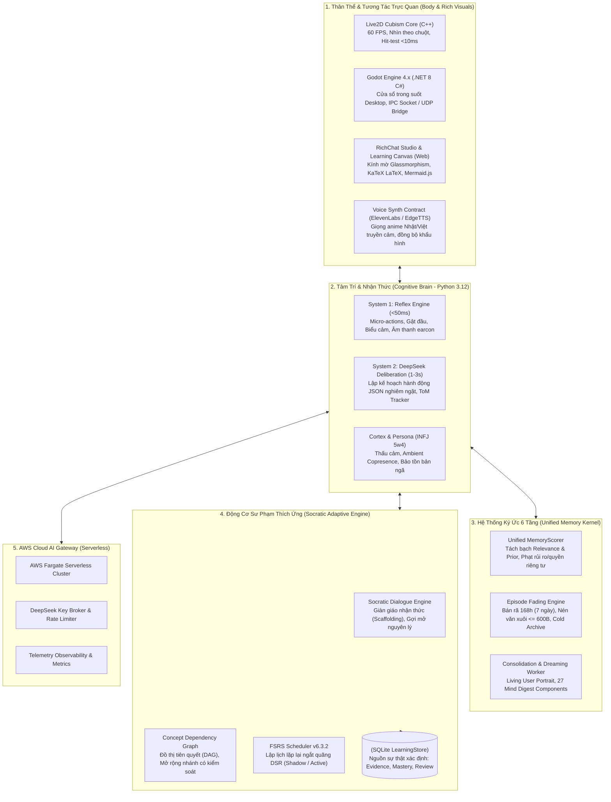

# ErisTutor: Sinh Thể Số Đồng Hành & Gia Sư Socrates Thích Ứng

<p align="left">
  
  
  
  
  
  
</p>

> 🌟 **ErisTutor** là lớp nhận thức học tập của **Eris AI** — một sinh thể số đồng hành trên desktop Windows, sở hữu thân thể Live2D 60 FPS (Godot/C#) và một bộ não nhận thức cao cấp viết bằng Python 3.12, tích hợp **AWS Cloud AI Gateway** (DeepSeek Key Broker & Telemetry Observability).

---

## 📖 Mục Lục

1. [Tổng Quan Cốt Lõi](#-tổng-quan-cốt-lõi)
2. [Kiến Trúc Hybrid 4 Phân Hệ & AWS Gateway](#-kiến-trúc-hybrid-4-phân-hệ--aws-gateway)
3. [Ranh Giới Quyền Sở Hữu & Các Bất Biến (Invariants)](#-ranh-giới-quyền-sở-hữu--các-bất-biến-invariants)
4. [Kiến Trúc Đa Tầng & Khế Ước Ngôn Ngữ (Polyglot & Linguistics)](#-kiến-trúc-đa-tầng--khế-ước-ngôn-ngữ-polyglot--linguistics)
5. [Cấu Trúc Thư Mục](#-cấu-trúc-thư-mục)
6. [Yêu Cầu Môi Trường & Cài Đặt](#-yêu-cầu-môi-trường--cài-đặt)
7. [Khởi Chạy & Kiểm Thử](#-khởi-chạy--kiểm-thử)
8. [Bản Đồ Tài Liệu Tri Thức Hệ Thống](#-bản-đồ-tài-liệu-tri-thức-hệ-thống)
9. [Lộ Trình Phát Triển & Trạng Thái Bằng Chứng](#-lộ-trình-phát-triển--trạng-thái-bằng-chứng)

---

## 💡 Tổng Quan Cốt Lõi

ErisTutor **không phải** là một chatbot hỏi-đáp bài tập đơn thuần hay một lớp vỏ bọc LLM (LLM wrapper) thụ động. Eris được thiết kế để trở thành:

- **Sinh Thể Số Đồng Hành (Digital Companion - INFJ 5w4 / Tritype 594)**: Hiện diện nhẹ nhàng trên màn hình desktop (`ambient_copresence`). Thấu hiểu tâm lý qua Thuyết Tâm Trí (Theory of Mind), tôn trọng sự tĩnh lặng khi bạn tập trung, và kiên quyết loại bỏ mọi văn mẫu chăm sóc khách hàng rỗng tuếch (`social_surface_chatter_dislike`).
- **Gia Sư Socrates Thích Ứng (Adaptive Socratic Tutor)**: Kiên trì nguyên tắc **chống mớm đáp án** (Anti-spoon-feeding). Eris dẫn dắt người học qua Vùng Phát Triển Gần Nhất (Vygotsky ZPD), dựng giàn giáo nhận thức (Scaffolding 4 cấp độ), chẩn đoán ngộ nhận (`misconception`) dựa trên Đồ thị Phụ thuộc Khái niệm (Concept DAG), và lập lịch lặp lại ngắt quãng bằng thuật toán **FSRS v6.3.2**.
- **Nguồn Sự Thật Xác Định (Deterministic Single Source of Truth)**: Điểm thành thạo (`mastery`), lịch sử làm bài (`attempts`) và bằng chứng học tập (`evidence`) do **SQLite LearningStore** quản lý độc quyền. LLM và giao diện web chỉ đóng vai trò đề xuất hoặc read-model, không bao giờ được tự tiện ghi đè mastery.

---

## 🏛 Kiến Trúc Hybrid 4 Phân Hệ & AWS Gateway



---

## 🔒 Ranh Giới Quyền Sở Hữu & Các Bất Biến (Invariants)

Để bảo đảm tính ổn định và tính toàn vẹn sư phạm, các ranh giới kiến trúc sau là **bất biến tuyệt đối** (xem [D02 — Bản đồ kiến trúc](docs/ERISTUTOR_20261107_V02_D02_SYSTEM_KNOWLEDGE_ATLAS.md)):

| Luồng nghiệp vụ | Chủ sở hữu duy nhất (Owner) | Điều cấm kỵ (Forbidden) |
| :--- | :--- | :--- |
| **Quyền phát ngôn & Lời nói** | `Root` / `ConversationDirector` | Không cho phép Tutor daemon hay UI panel tự ý cướp kênh public speech. Tutor chỉ gửi đề xuất hành động. |
| **Bằng chứng & Điểm thành thạo** | `LearningService` + `SQLiteStore` | Nghiêm cấm UI, C#, hay LLM tự động cập nhật phần trăm mastery. Câu trả lời tự tin của LLM không phải bằng chứng người học tự làm đúng. |
| **Bài làm độc lập vs có gợi ý** | `AssessmentStore` | Bài làm có xem gợi ý (`hinted`) hoặc mở đáp án (`revealed`) tuyệt đối không được ghi nhận như kết quả giải độc lập (`independent`). |
| **Bộ nhớ cá nhân & Sở thích** | `living_user` (phạm vi riêng) | Không trộn sở thích cá nhân (chủ đề quan tâm) với tri thức kỹ thuật đã thành thạo. |
| **Nguyên tắc truy hồi bộ nhớ** | `Unified MemoryScorer` | *"Prior không được cứu ký ức không liên quan!"* Nếu $\text{relevance} < \text{min\_relevance}$, điểm tổng $\text{total} = 0.0$. |

---

## 🌐 Kiến Trúc Đa Tầng & Khế Ước Ngôn Ngữ (Polyglot & Linguistics)

*Chi tiết*: [ARCH-LANG-01: Polyglot Architecture & Linguistics](docs/knowledge/2026-11-08-polyglot-tech-stack-and-linguistics.md)

### 1. Kiến Trúc Kỹ Thuật Đa Tầng (Polyglot Stack)
- **C++ (Live2D Cubism Core SDK)**: Đồ họa nhân vật 60 FPS, hit-testing chuột xuyên thấu với độ trễ $< 10\text{ms}$, quản lý bộ nhớ native tránh rò rỉ tài nguyên.
- **C# / .NET 8 (Godot Engine 4.x)**: Quản lý cửa sổ desktop trong suốt (transparent borderless), điều phối cầu nối liên tiến trình (IPC / UDP Bridge), nhúng Webview.
- **Python 3.12 (Cognitive Brain & Runtime)**: Trái tim nhận thức trung tâm gồm Cortex INFJ 5w4, Unified Memory Kernel 6 tầng, Socratic Tutor, và Fast-fail Model Router.
- **HTML5 / CSS3 / JavaScript (ES6+)**: Giao diện RichChat Studio và bảng vẽ số Learning Canvas (kính mờ glassmorphism, render công thức KaTeX, sơ đồ Mermaid, highlight code Prism).

### 2. Khế Ước Ngôn Ngữ Tự Nhiên & Ngữ Âm
- **Tiếng Việt (Cognitive Core)**: Ngôn ngữ độc thoại nội tâm (Inner Deliberation), suy luận System 2, phân tích Thuyết Tâm Trí (ToM) và đối thoại sư phạm chuẩn mực, ấm áp. Có module xử lý NFD và bộ lọc 70 stopwords tiếng Việt đặc thù.
- **Tiếng Nhật (Speech Persona)**: Bản sắc giọng nói anime trong trẻo qua ElevenLabs/Voice model tùy biến, đồng bộ chuyển động môi Live2D theo các nguyên âm $A, I, U, E, O$. Hỗ trợ cơ chế chuyển đổi linh hoạt Việt/Nhật (Live VI/JA TTS Switch).
- **Tiếng Anh (Technical Grounding)**: Thuật ngữ lập trình quốc tế (`Closure`, `Thread Pool`, `Dependency Injection`), quy chuẩn API schema và tài liệu kỹ thuật.

---

## 📁 Cấu Trúc Thư Mục

```text
ErisTutor/
├── src/                               # Toàn bộ mã nguồn Runtime & Thân thể
│   ├── body/                          # Cầu nối Godot C# (.NET 8), UDP listener & RichChat web
│   ├── runtime/                       # Runtime nhận thức, Coordinator, Learning Core & Canvas
│   │   ├── learning_core/             # Lõi học tập xác định (Evidence, Mastery, SQLite Store)
│   │   ├── learning_canvas/           # Dịch vụ Canvas, packs (java-di), bài tập, focus
│   │   ├── tutor/                     # Socratic Tutor Executive, Insights & Adaptive Policy
│   │   └── conversation/              # Điều phối hội thoại, Context Assembler
│   ├── memory/                        # Hệ thống ký ức 6 tầng (105 modules)
│   │   ├── living_user/               # Living User Portrait, Narrative Rollups, Dreaming
│   │   ├── memory_scoring.py          # Unified MemoryScorer (Relevance, Priors, Penalties)
│   │   ├── episodic_memory.py         # Ký ức sự kiện & cơ chế Episode Fading 168h
│   │   └── ...                        # Semantic, Procedural, Relational, Repair, Affective
│   ├── cortex/                        # Nhận thức bậc cao, bản ngã INFJ 5w4, Thuyết tâm trí (ToM)
│   ├── llm/                           # AI Gateway, DeepSeek Process Manager & Web lanes
│   └── vision.py                      # Entrypoint điều phối cấp cao của Eris
├── docs/                              # Toàn bộ kho tài liệu tri thức kiến trúc
│   ├── ERISTUTOR_DEEP_ARCHITECTURE_SPEC.md   # Đặc tả kiến trúc toàn diện v2.0
│   ├── ERISTUTOR_20261107_V02_D01_START_HERE.md ... D08  # Bộ tài liệu D01 - D08
│   └── knowledge/                     # Các chuyên khảo kỹ thuật sâu (ARCH-MEM, ARCH-COG, ...)
├── tests/                             # Bộ kiểm thử tự động toàn diện (317 test cases)
├── tools/                             # Công cụ phụ trợ (whale2api, repo_context, harvest)
├── run_eris.bat                       # Khởi chạy toàn bộ Eris Desktop (Godot Body + Python Runtime)
├── run_runtime.bat                    # Khởi chạy riêng biệt Python Cognitive Runtime (Console)
├── run_tests.py                       # Bộ chạy kiểm thử tự động toàn diện
├── requirements.txt                   # Thư viện runtime bắt buộc
└── requirements-dev.txt               # Thư viện phát triển và CI (pytest, ruff, mss, Pillow)
```

---

## 💻 Yêu Cầu Môi Trường & Cài Đặt

### 1. Yêu Cầu Hệ Thống
- **Hệ điều hành**: **Windows 10 / 11 (64-bit)** (bắt buộc vì runtime sử dụng các API đặc thù của Windows: `msvcrt`, `tasklist`, `CREATE_NO_WINDOW`).
- **Python**: **Python 3.12** (khuyến nghị) hoặc `>= 3.11`.
- **.NET SDK**: **.NET 8.0 SDK** (dành cho phần Godot C# Body).
- **Godot Engine**: Godot 4.x hỗ trợ .NET/C# (nếu chạy kèm giao diện nhân vật Live2D).

### 2. Các Bước Cài Đặt

```powershell
# 1. Clone repository
git clone https://github.com/Gtvkun/ErisTutor.git
cd ErisTutor

# 2. Khởi tạo môi trường ảo Python 3.12
python -m venv .venv
.\.venv\Scripts\Activate.ps1

# 3. Nâng cấp pip và cài đặt dependencies phát triển
python -m pip install --upgrade pip
pip install -r requirements-dev.txt

# 4. (Tùy chọn) Cài đặt asset Live2D Body
.\install_live2d_body.bat
```

> [!NOTE]
> File cấu hình `.env` và `config/secrets.json` sẽ được tự động tạo từ bản mẫu (`.example`) khi bạn khởi chạy ứng dụng lần đầu. Bạn có thể cập nhật API Key tương ứng trong các file này.

---

## 🚀 Khởi Chạy & Kiểm Thử

### 1. Khởi Chạy Ứng Dụng

| Lệnh thực thi | Mô tả |
| :--- | :--- |
| `.\run_eris.bat` | Khởi chạy toàn diện **Eris Desktop** (Thân thể Live2D Godot GUI + Não bộ Python Runtime). |
| `.\run_runtime.bat` | Khởi chạy riêng biệt **Python Cognitive Runtime** (chế độ dòng lệnh / headless). |

### 2. Chạy Bộ Kiểm Thử Tự Động (CI Gate)

Dự án duy trì quy chuẩn kiểm thử nghiêm ngặt. Mọi commit và Pull Request đều phải vượt qua toàn bộ các cổng kiểm tra trên CI GitHub Actions (`windows-latest`):

```powershell
# Thiết lập biến môi trường chuẩn UTF-8 và PYTHONPATH
$env:PYTHONUTF8 = "1"
$env:PYTHONPATH = "src"

# 1. Kiểm tra chất lượng mã nguồn (Linting)
.\.venv\Scripts\ruff.exe check src tests

# 2. Thực thi toàn bộ 317 test cases (Unit & Integration)
python run_tests.py
```

Kết quả mong đợi:
```text
317 passed in ~37s (100% PASS)
```

---

## 📚 Bản Đồ Tài Liệu Tri Thức Hệ Thống

Toàn bộ hệ thống được ghi nhận minh bạch và chi tiết trong thư mục [`docs/`](docs/):

### Bộ Tài Liệu Định Hướng Cốt Lõi (D01 – D08)
- [D01 — Bắt đầu từ đây](docs/ERISTUTOR_20261107_V02_D01_START_HERE.md): Khái quát và hướng dẫn lộ trình đọc tài liệu.
- [D02 — Bản đồ kiến trúc](docs/ERISTUTOR_20261107_V02_D02_SYSTEM_KNOWLEDGE_ATLAS.md): Bản đồ phân tầng và ranh giới quyền sở hữu bất biến.
- [D03 — Đồ thị tri thức](docs/ERISTUTOR_20261107_V02_D03_CURRICULUM_GRAPH.md): Đồ thị kiến thức thực tế (Java DI Pack) và cấu trúc ontology.
- [D04 — Dữ liệu & I/O](docs/ERISTUTOR_20261107_V02_D04_DATA_AND_IO.md): Luồng ghi chứng cứ bài làm, bất biến dữ liệu và giao dịch SQLite.
- [D05 — Kiểm kê hiện tại](docs/ERISTUTOR_20261107_V02_D05_CURRENT_AUDIT.md): Bảng phân loại tính năng đã có mã nguồn, đã kiểm thử và các khoảng trống.
- [D06 — Lộ trình phát triển](docs/ERISTUTOR_20261107_V02_D06_ROADMAP.md): Lộ trình 5 giai đoạn từ P0 đến P4.
- [D07 — Backlog triển khai](docs/ERISTUTOR_20261107_V02_D07_IMPLEMENTATION_BACKLOG.md): Danh mục công việc chi tiết từ `LT-001` đến `LT-012`.
- [D08 — Quản trị hệ thống](docs/ERISTUTOR_20261107_V02_D08_GOVERNANCE.md): Quy ước đặt tên, quy tắc kiểm soát phiên bản và hồ sơ ADR.

### Bộ Đặc Tả Kiến Trúc Chuyên Sâu (Production Specifications)
- [Đặc Tả Kiến Trúc Toàn Diện v2.0](docs/ERISTUTOR_DEEP_ARCHITECTURE_SPEC.md): Tài liệu hợp nhất toàn diện 4 trụ cột hệ thống.
- [ARCH-MEM-01: Memory Scoring & Weights](docs/knowledge/2026-11-08-memory-scoring-weights-and-prior-architecture.md): Trọng số 6 tầng ký ức, công thức Relevance, Priors, Penalties.
- [ARCH-MEM-02: Memory Consolidation & Digests](docs/knowledge/2026-11-08-memory-consolidation-summary-and-digests.md): Chân dung người học sống động, nén tự sự $\le 600$B, Dreaming, 27 Mind Digest components.
- [ARCH-MEM-03: Episodic Memory & Episode Fading](docs/knowledge/2026-11-08-episodic-memory-and-episode-fading.md): Ký ức sự kiện, bán rã 168h, nén văn xuôi, Cold Archive chống nhớ vặt.
- [ARCH-COG-01: Cognitive Architecture & INFJ 5w4](docs/knowledge/2026-11-08-cognitive-psychology-and-persona-infj.md): Jungian Stack, Enneagram 5w4/594, Ambient Copresence, Theory of Mind, System 1/2.
- [ARCH-TUTOR-01: Pedagogical Foundations & Adaptive Tutor](docs/knowledge/2026-11-08-pedagogical-foundations-socratic-tutor.md): Phương pháp Socrates, Vygotsky ZPD, Scaffolding 4 cấp độ, Concept DAG, FSRS v6.3.2.
- [ARCH-LANG-01: Polyglot Architecture & Linguistics](docs/knowledge/2026-11-08-polyglot-tech-stack-and-linguistics.md): Polyglot Stack (C++/C#/Python/Web) và Khế ước ngôn ngữ tự nhiên (Việt/Nhật/Anh).

---

## 🗺 Lộ Trình Phát Triển & Trạng Thái Bằng Chứng

Hệ thống tuân thủ nguyên tắc **báo cáo dựa trên bằng chứng kỹ thuật, không tô hồng**:

```text
[ CÓ CODE + 317 TESTS PASS ]  ──►  [ P0: INDEX PROJECTION ]  ──►  [ P1: ĐA MÔN CANVAS ]
• SQLite LearningStore xác định      • Root chỉ lấy tên môn ngắn     • Registry nạp đa pack
• Socratic Tutor & Insights           khi đóng panel                 • Đồ thị lazy mở nhánh
• Hệ thống ký ức 6 tầng              • Tránh phình context token     • Khôi phục trạng thái focus
• 317 Unit/Integration tests pass
                                             │
                                             ▼
[ P4: RELEASE GATE ]          ◄──  [ P3: GENERATIVE DRAFT ]  ◄──  [ P2: TOÀN BỘ EVIDENCE ]
• Benchmark độ trễ / token           • Gemini sinh bản nháp nhánh   • Timeline bài làm & review
• E2E Desktop Windows thật           • Chốt CAS + DAG validation    • Phiếu nhận chứng cứ receipt
• Phát hành phiên bản chính thức     • Topic Observation riêng biệt • Chế độ FSRS chính quy
```

- **Đã Kiểm Chứng & Đạt Chuẩn**: Toàn bộ lõi nhận thức Python (Learning Core, Socratic Tutor, Unified Memory Kernel 6 tầng, FSRS, Cortex ToM) đã qua kiểm thử với **317/317 tests đạt 100%**.
- **Kế Hoạch Tiếp Theo**: Triển khai tối ưu hóa chỉ mục Root khi đóng panel (P0), mở rộng Canvas đa môn động (P1) và hoàn thiện kiểm chứng E2E toàn luồng trên desktop Windows (P4).

---

<p align="center">
  Phát triển với sự tận tâm bởi đội ngũ <b>Eris AI</b> • 2026
</p>
