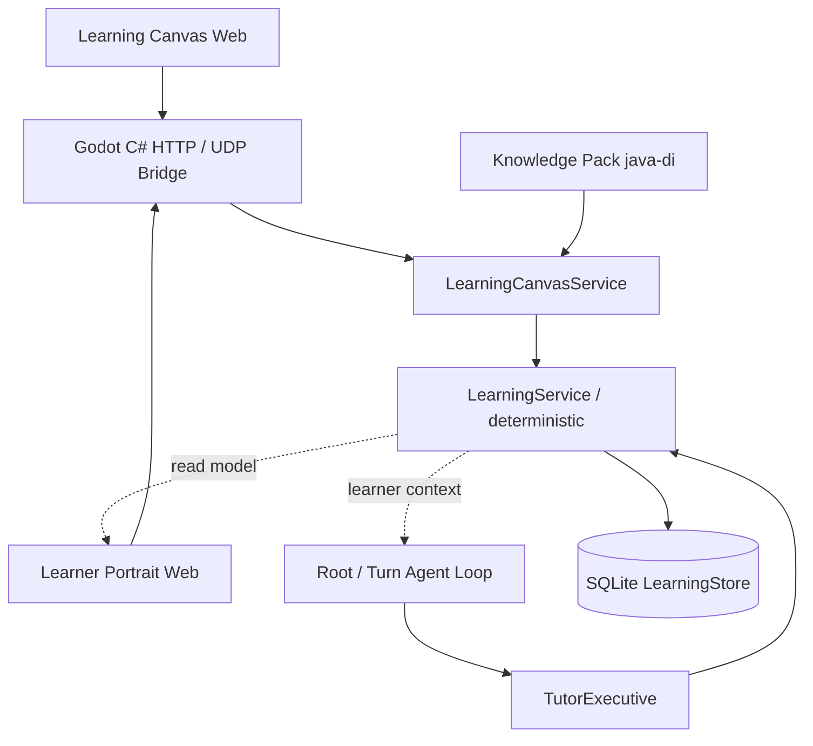

# Bản đồ kiến trúc tri thức

> **Mốc tài liệu:** 07/11/2026 · 15:00 (GMT+7) · Bản Markdown V02  
> **Trạng thái:** Phân tích source tại thời điểm trên; kế hoạch P0–P4 là đề xuất, chưa phải kết quả hoàn thành.  
> **Điều hướng:** [README](../README.md) · [Mục lục tài liệu](./ERISTUTOR_20261107_V02_D01_START_HERE.md)

Ai giữ dữ liệu, ai quyết định sư phạm, ai hiển thị, ai có quyền nói.

| **Ngày lập / mốc đối chiếu** | 07/11/2026 • 15:00 (UTC+07:00)     |
|------------------------------|------------------------------------|
| **Phạm vi / loại tài liệu**  | Ảnh chụp source + kế hoạch đề xuất |

Nguồn phân tích: ErisTutor.zip → ErisTutor/eris-ai-20261107_114652_625.zip → eris/

**Quy ước bằng chứng:** CÓ CODE = đọc được mã nguồn; TEST OK = test offline chạy qua; CHƯA E2E = chưa xác nhận toàn luồng Windows/Gemini; ĐỀ XUẤT = chưa triển khai.

## 1. Bản đồ 6 lớp

### Sơ đồ Mermaid (chỉnh sửa trực tiếp trong Markdown)

*Sơ đồ 1 — liên kết thực trong mã nguồn, mũi tên đứt là dữ liệu chiếu/chuyển ngữ cảnh.*

| **Lớp**            | **Module tiêu biểu**                                         | **Trách nhiệm**                                                       |
|--------------------|--------------------------------------------------------------|-----------------------------------------------------------------------|
| 01 • Giao diện     | src/body/richchat/canvas.\*; portrait/\*                     | Hiển thị graph, bài tập, read-model; không tự chấm mastery.           |
| 02 • Bridge        | src/body/UdpListener.WebLearningCanvas.cs; RichChatPortal.cs | HTTP loopback + token → UDP request/ACK, gọi từ Godot main thread.    |
| 03 • Điều phối     | src/runtime/coordinator.py; tutor/executive.py               | Root sở hữu lời thoại, Tutor đề xuất bước dạy theo trạng thái.        |
| 04 • Canvas        | runtime/learning_canvas/service.py; pack.py; focus.py        | Chọn node, exercise, focus revision và snapshot read-model.           |
| 05 • Learning Core | runtime/learning_core/service.py; mastery.py; retention.py   | Commit evidence deterministic; mastery, review, revision/path.        |
| 06 • Lưu trữ       | runtime/learning_core/store.py + catalog.py                  | SQLite path, skill, attempts, provenance, projections; nguồn sự thật. |

## 2. Quan hệ giữa các thành phần

- Root là người quyết định có dạy, nói hay im lặng; TutorCapability/TutorExecutive cung cấp kế hoạch và quan sát. Không có agent loop dạy riêng cạnh tranh với Root.

- LLM/Gemini có thể lập curriculum đề xuất và diễn giải người học; đường ghi bền vững phải qua kiểm soát xác định của LearningService/SQLite.

- Web Canvas và Learner Portrait là hai góc nhìn khác nhau: Canvas thao tác bài học; Portrait chỉ xem và tóm tắt tiến độ bằng chứng.

- Memory/living_user chỉ đưa sở thích học rõ ràng vào LearnerProfile; không được thay thế AssessmentAttempt và LearningEvidence.

- Outer ErisTutor/src/UdpListener.cs không giống bản lồng eris/src/body/UdpListener.cs; cần đối chiếu phiên build thực trước khi merge/chạy.

## 3. Lý tưởng mở rộng — ranh giới không được phá

| **Luồng**          | **Owner duy nhất**                             | **Không được làm**                                       |
|--------------------|------------------------------------------------|----------------------------------------------------------|
| Gợi ý nội dung     | Model → đề xuất; validator quyết định revision | Không ghi thẳng skill/mastery từ câu trả lời model.      |
| Bằng chứng làm bài | LearningService + AssessmentStore              | Không coi hỏi/đọc/gợi ý là bằng chứng tự giải.           |
| Điểm nắm vững      | Projection deterministic trong Core            | Không để UI hoặc Gemini tự suy ra phần trăm.             |
| Lời nói/TTS        | Root/ConversationDirector                      | Không để Tutor daemon hoặc panel tự chiếm public speech. |
| Bộ nhớ cá nhân     | living_user, scope/consent riêng               | Không trộn chủ đề quan tâm với tri thức đã thành thạo.   |

### Dấu vết mã nguồn / căn cứ

- src/runtime/learning_core/service.py

- src/runtime/tutor/executive.py

- src/runtime/tutor/learner_context.py

- src/runtime/learning_canvas/service.py

- src/body/UdpListener.WebLearningCanvas.cs

- src/runtime/learner_portrait.py

---

[← Quay về README](../README.md) · *Đối chiếu source ngày 07/11/2026; không suy đoán trạng thái đã triển khai sau mốc này.*
