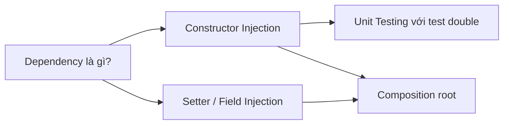

# Bản đồ tri thức đang có

> **Mốc tài liệu:** 07/11/2026 · 15:00 (GMT+7) · Bản Markdown V02  
> **Trạng thái:** Phân tích source tại thời điểm trên; kế hoạch P0–P4 là đề xuất, chưa phải kết quả hoàn thành.  
> **Điều hướng:** [README](../README.md) · [Mục lục tài liệu](./ERISTUTOR_20261107_V02_D01_START_HERE.md)

Graph kiểm chứng được từ knowledge pack; tách bạch dữ liệu có thật và ontology mong muốn.

| **Ngày lập / mốc đối chiếu** | 07/11/2026 • 15:00 (UTC+07:00)     |
|------------------------------|------------------------------------|
| **Phạm vi / loại tài liệu**  | Ảnh chụp source + kế hoạch đề xuất |

Nguồn phân tích: ErisTutor.zip → ErisTutor/eris-ai-20261107_114652_625.zip → eris/

**Quy ước bằng chứng:** CÓ CODE = đọc được mã nguồn; TEST OK = test offline chạy qua; CHƯA E2E = chưa xác nhận toàn luồng Windows/Gemini; ĐỀ XUẤT = chưa triển khai.

## 1. Graph kiến thức đã xác minh

### Đồ thị tri thức Mermaid (5 KnowledgePoint)

**Lưu ý:** Các cạnh là điều kiện tiên quyết của curriculum có sẵn, không phải dữ liệu người học đã hoàn thành.

Gói nguồn: eris/src/runtime/learning_canvas/packs/java-di.json. Pack schema eris.learning.pack.v1; group_id = java-di, namespace = javadi:v1, path = javadi:v1:path. Đây là curriculum ví dụ tích hợp trong mã nguồn, KHÔNG phải hồ sơ mastery cá nhân.

*Sơ đồ 2 — cạnh thể hiện “cần học trước” (prerequisite).*

| **KnowledgePoint**           | **Điều kiện tiên quyết**             | **Blocks / bài tập** |
|------------------------------|--------------------------------------|----------------------|
| Dependency là gì?            | Không                                | 2 blocks / 1 bài     |
| Constructor Injection        | Dependency                           | 2 blocks / 2 bài     |
| Setter / Field Injection     | Dependency                           | 2 blocks / 1 bài     |
| Unit Testing với test double | Constructor Injection                | 2 blocks / 1 bài     |
| Composition root             | Constructor Injection + Setter/Field | 2 blocks / 1 bài     |

Tổng hiện có: 5 KnowledgePoint, 10 khối nội dung, 6 bài luyện. Các nút không có trạng thái “đã học” cố định trong pack; trạng thái được chiếu từ LearningService cho từng người học khi có dữ liệu.

## 2. Ontology hệ học tập

| **Thực thể**                           | **Quan hệ**                                      | **Trạng thái**                                      |
|----------------------------------------|--------------------------------------------------|-----------------------------------------------------|
| Domain → LearningPath                  | Nhóm môn và lộ trình                             | CÓ CODE (DomainSpec, LearningPath, learning_spaces) |
| LearningPath → KnowledgePoint          | Thuộc về môn, skill ID có namespace              | CÓ CODE                                             |
| KnowledgePoint → KnowledgePoint        | prerequisites là đồ thị có hướng không chu trình | CÓ CODE, validator                                  |
| KnowledgePoint → Activity / ItemFamily | Hoạt động kiểm tra một mục kiến thức             | CÓ CODE trong Canvas/Assessment                     |
| Attempt → Evidence                     | Kết quả + loại trợ giúp + provenance             | CÓ CODE, transaction                                |
| Evidence → Mastery / Belief / Review   | Projection có thể tính lại                       | CÓ CODE, BKT không calibrated                       |
| SourceSpan → Curriculum                | Nguồn có version, locator, hash                  | CÓ CODE, nhập Text/Markdown                         |
| Cross-domain SAME_AS / BRANCH_PREFETCH | Gợi ý liên ngành và nạp trước nhánh ẩn           | ĐỀ XUẤT, chưa có bằng chứng live tổng quát          |

## 3. Mở rộng graph theo yêu cầu sản phẩm

1.  Trong trạng thái panel đóng, Root chỉ thấy tên môn/ngắn gọn và path_id; không lấy KP/mastery/review mỗi lượt.

2.  Khi người học mở Learning, lấy danh sách spaces + phần đầu đồ thị cho môn đang chọn; mở 1 nhánh thì lấy children của nhánh đó (lazy).

3.  Gemini có thể tạo trước nội dung vài nhánh sắp mở nhưng chỉ lưu bản DRAFT có giới hạn, không biến thành curriculum chính thức trước validator.

4.  Khi user chọn nhánh hoặc bấm “học”, dùng source refs, version và DAG validation; commit qua preview/revise có CAS.

5.  Bài luyện tạo attempt; xác nhận đã nhận/hoàn thành và ghi mức hỗ trợ; sau đó mới cập nhật mastery/review.

## 4. Hạn chế của snapshot hiện thời

Canvas service mặc định load một pack (java-di), Web bridge gửi group_id “java-di”, snapshot giới hạn tối đa 16 KP (pack cũng giới hạn 16 nodes). Vì vậy UI web chưa phải hệ đồ thị tự sinh/duyệt được nhiều môn vô hạn. Learner Portrait có thể liệt kê nhiều paths nhưng không có nghĩa Canvas đã chuyển môn linh hoạt.

### Dấu vết mã nguồn / căn cứ

- src/runtime/learning_canvas/packs/java-di.json

- src/runtime/learning_canvas/pack.py: validate_pack()

- src/runtime/learning_canvas/snapshot.py

- src/runtime/learning_core/catalog.py

- src/runtime/learning_core/contracts.py

- src/body/UdpListener.WebLearningCanvas.cs

---

[← Quay về README](../README.md) · *Đối chiếu source ngày 07/11/2026; không suy đoán trạng thái đã triển khai sau mốc này.*
