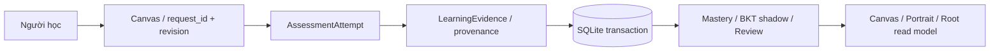

# Dữ liệu, I/O và vòng đời học tập

> **Mốc tài liệu:** 07/11/2026 · 15:00 (GMT+7) · Bản Markdown V02  
> **Trạng thái:** Phân tích source tại thời điểm trên; kế hoạch P0–P4 là đề xuất, chưa phải kết quả hoàn thành.  
> **Điều hướng:** [README](../README.md) · [Mục lục tài liệu](./ERISTUTOR_20261107_V02_D01_START_HERE.md)

Contract then chốt để giữ evidence đúng, tách read-model khỏi quyền ghi.

| **Ngày lập / mốc đối chiếu** | 07/11/2026 • 15:00 (UTC+07:00)     |
|------------------------------|------------------------------------|
| **Phạm vi / loại tài liệu**  | Ảnh chụp source + kế hoạch đề xuất |

Nguồn phân tích: ErisTutor.zip → ErisTutor/eris-ai-20261107_114652_625.zip → eris/

**Quy ước bằng chứng:** CÓ CODE = đọc được mã nguồn; TEST OK = test offline chạy qua; CHƯA E2E = chưa xác nhận toàn luồng Windows/Gemini; ĐỀ XUẤT = chưa triển khai.

## 1. Luồng I/O có thể kiểm tra

### Sơ đồ Mermaid: từ bài làm tới dữ liệu chứng cứ

*Sơ đồ 3 — dòng xử lý từ bài làm đến nhận định và bước học tiếp.*

| **Điểm**        | **Input**                                                | **Output / tác động**                                           |
|-----------------|----------------------------------------------------------|-----------------------------------------------------------------|
| Canvas Web      | action + request_id + node_id + revision (+ code/answer) | UDP command → backend ACK + learning_canvas snapshot            |
| CanvasService   | open/navigate/exercise/submit/hint/reveal                | focus/activity state; enqueue event cho Root nếu phù hợp        |
| Assessment      | result, assistance, family, revision, provenance         | Attempt idempotent, evidence và correction chain                |
| LearningService | Evidence / path/source change đã validate                | SQLite transaction + cập nhật projection                        |
| Portrait        | learning_spaces / learning_insights / Mentor             | Trang kiến thức, chứng cứ và Gemini observations có source_refs |
| Root            | learner_continuity_snapshot (read-only)                  | Context hỗ trợ phản hồi; không ghi mastery trực tiếp            |

## 2. Cấu trúc lưu trữ logic

- learning_paths, knowledge_points, learning_path_revisions, learning_path_skills: domain và curriculum; giữ định danh theo namespace.

- learning_evidence, assessment attempts, interactions: mỗi quan sát có attempt/result/assistance, idempotency và lịch sử sửa.

- mastery_records, learner_beliefs, review_memory, review_items: projection học tập có thể tính lại, tách mastery và BKT shadow.

- learning_domains, learning_source_versions, learning_source_spans: nguồn trích có locator, content hash, hiện hành/cũ.

- focus/playback/activity và metadata canvas: thuộc trải nghiệm điều hướng; không đồng nghĩa đã nắm vững.

## 3. Các invariant phải giữ khi cải tiến

| **Bất biến**        | **Điều kiện kiểm chứng**                                                    |
|---------------------|-----------------------------------------------------------------------------|
| Quyền sở hữu        | Không có đường ghi mastery trực tiếp từ JS/C#/Gemini.                       |
| Không nhân chứng cứ | Cùng request_id + same content retry không sinh attempt/evidence mới.       |
| Bài có gợi ý        | correct nhưng hinted/revealed không được tính như independent.              |
| Sửa / quên          | Correction giữ thời điểm gốc, forget reproject + chặn replay hồi sinh.      |
| Revision            | Curriculum dùng preview + CAS, stale revision phải bị từ chối.              |
| Cập nhật đa môn     | switch path không reset attempts/review của môn cũ.                         |
| Fallback            | Gemini/FSRS/Docling không sẵn không làm sập Root hoặc báo giả độ chắc chắn. |
| Read-only portrait  | Chọn mục trên Portrait không activate path hoặc write core.                 |

## 4. Loại hồ sơ cần phân biệt

Learning Core trả evidence và mastery ước lượng; Learner Portrait/Gemini chỉ diễn giải tín hiệu có source_refs; LivingUser chứa sở thích user đã nêu; Topic Observation (từ hội thoại) hiện là roadmap chứ không nên trộn vào mastery. “Đã quan tâm” không tương đương “đã làm đúng độc lập”.

### Dấu vết mã nguồn / căn cứ

- src/runtime/learning_core/store.py

- src/runtime/learning_core/records.py

- src/runtime/learning_core/retention.py

- src/runtime/learning_canvas/service.py

- src/runtime/learner_portrait.py

- src/runtime/tutor/learner_context.py

---

[← Quay về README](../README.md) · *Đối chiếu source ngày 07/11/2026; không suy đoán trạng thái đã triển khai sau mốc này.*
