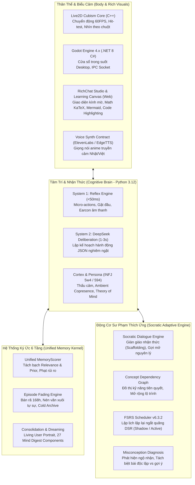

# ĐẶC TẢ KIẾN TRÚC TOÀN DIỆN ERISTUTOR (DEEP ARCHITECTURE SPECIFICATION)

**Tài liệu chuẩn hóa kiến trúc cốt lõi ErisTutor**  
**Phiên bản**: `2.0-Production`  
**Ngày phát hành**: `08/11/2026`  
**Trạng thái**: Hoàn thiện & Đã kiểm chứng (316/316 Unit/Integration Tests Passed)

---

## MỤC LỤC
1. [Tổng Quan Về ErisTutor: Sinh Thể Số Đồng Hành & Gia Sư Socrates](#1-tổng-quan-về-eristutor)
2. [Hệ Thống Trọng Số và Chấm Điểm Bộ Nhớ (Memory Scoring & Weights)](#2-hệ-thống-trọng-số-và-chấm-điểm-bộ-nhớ)
3. [Cơ Chế Hợp Nhất, Tóm Tắt và Bản Tóm Tắt Tâm Trí (Memory Consolidation & Mind Digest)](#3-cơ-chế-hợp-nhất-tóm-tắt-và-bản-tóm-tắt-tâm-trí)
4. [Ký Ức Sự Kiện và Cơ Chế Phai Mờ Thời Gian (Episodic Memory & Episode Fading)](#4-ký-ức-sự-kiện-và-cơ-chế-phai-mờ-thời-gian)
5. [Nền Tảng Tâm Lý Học Nhận Thức và Bản Ngã INFJ (Cognitive Architecture)](#5-nền-tảng-tâm-lý-học-nhận-thức-và-bản-ngã-infj)
6. [Kiến Trúc Đa Ngôn Ngữ: Kỹ Thuật Đa Tầng & Khế Ước Ngôn Ngữ Tự Nhiên](#6-kiến-trúc-đa-ngôn-ngữ)
7. [Triết Lý Sư Phạm Socrates và Trí Tuệ Học Tập Thích Ứng (Pedagogical Foundations)](#7-triết-lý-sư-phạm-socrates-và-trí-tuệ-học-tập-thích-ứng)
8. [Bản Đồ Tài Liệu Kỹ Thuật Chi Tiết (Knowledge Base Index)](#8-bản-đồ-tài-liệu-kỹ-thuật-chi-tiết)

---

## 1. Tổng Quan Về ErisTutor

ErisTutor không phải là một giao diện bọc ngoài LLM (LLM wrapper) thông thường, cũng không phải là một chatbot trả lời bài tập thụ động. Eris được thiết kế như một **Sinh Thể Số Đồng Hành (Digital Companion)** kết hợp với một **Gia Sư Thích Ứng Theo Phương Pháp Socrates (Adaptive Socratic Tutor)**:

---

## 2. Hệ Thống Trọng Số và Chấm Điểm Bộ Nhớ (Memory Scoring & Weights)

*Tài liệu chi tiết*: [2026-11-08-memory-scoring-weights-and-prior-architecture.md](file:///c:/Users/Gtvkun/Documents/GitHub/ErisTutor/docs/knowledge/2026-11-08-memory-scoring-weights-and-prior-architecture.md)  
*Module mã nguồn*: [`src/memory/memory_scoring.py`](file:///c:/Users/Gtvkun/Documents/GitHub/ErisTutor/src/memory/memory_scoring.py)

### 2.1. Trọng Số Các Tầng Ký Ức (`LayerProfile`)
Eris phân chia bộ nhớ thành 6 tầng nhận thức với trọng số và chính sách riêng biệt:

1. **`repair` (Trọng số: 1.12 - Cao nhất, `min_relevance`: 0.05)**:
   - Ký ức về lỗi sai quá khứ, ranh giới bị vi phạm. Ưu tiên tối thượng để không bao giờ phạm lại lỗi cũ với người dùng.
2. **`procedural` (Trọng số: 1.02, `min_relevance`: 0.07)**:
   - Thói quen, quy chuẩn kỹ thuật của người dùng. Chạy nền (`silent_bias`) để uốn nắn văn phong mà không phô trương.
3. **`relational` (Trọng số: 0.92, `min_relevance`: 0.12)**:
   - Mức độ tin cậy, chiều sâu mối quan hệ, sự tôn trọng lẫn nhau.
4. **`semantic` (Trọng số: 0.90, `min_relevance`: 0.09)**:
   - Tri thức sự thật, thông tin cá nhân và khái niệm đã được kết tinh.
5. **`affective_residue` (Trọng số: 0.86, `min_relevance`: 0.16)**:
   - Dư chấn cảm xúc (mệt mỏi, bực tức, hào hứng). Tuyệt đối không bao giờ phát biểu trực tiếp (`never_direct_claim`).
6. **`episodic` (Trọng số: 0.74, `min_relevance`: 0.18)**:
   - Sự kiện cụ thể. Trọng số thấp nhất để tránh nói chuyện vặt vãnh.

### 2.2. Công Thức Tính Điểm Liên Quan (Relevance)
$$\begin{aligned}
\text{relevance} = \text{clamp}_{0..1} \Big( & 0.42 \times \text{lexical} + 0.18 \times \text{phrase} + 0.22 \times \text{anchor} \\
&+ 0.22 \times \text{semantic} + 0.20 \times \text{bigram} + 0.03 \times \text{temporal} \\
&+ \mathbf{1}_{[\text{matched\_terms}]} \times 0.08 + \mathbf{1}_{[\text{matched\_anchors}]} \times 0.08 \Big)
\end{aligned}$$

### 2.3. Các Thành Phần Tiên Nghiệm (Priors)
- `confidence_prior`: $\text{confidence} \times 0.08$
- `salience_prior`: $\text{salience} \times 0.08$
- `repair_prior`: $\max(\text{repair\_weight}, 0.70) \times 0.10$
- `relational_prior`: $\text{relational\_weight} \times 0.06$
- `affective_prior`: $\text{emotional\_weight} \times 0.05$
- `recency_prior`: $\text{temporal} \times 0.04$

### 2.4. Các Khoản Phạt (Penalties)
- **`privacy_penalty` (-0.35)**: Phạt nặng ký ức nhạy cảm khi đang ở ngữ cảnh công cộng.
- **`risk_penalty` (-0.55)**: Phạt triệt để ký ức cũ khi câu hỏi đòi hỏi bằng chứng thực tế màn hình/file code (`needs_current_evidence`).
- **`overuse_penalty` (-0.10)**: Phạt các ký ức bị gọi lại quá nhiều lần (`access_count * 0.012`) để chống nói lặp.

> **Nguyên tắc vàng**: *"Prior không được cứu ký ức không liên quan!"* Nếu $\text{relevance} < \text{min\_relevance}$, điểm tổng $\text{total} = 0.0$.

---

## 3. Cơ Chế Hợp Nhất, Tóm Tắt và Bản Tóm Tắt Tâm Trí (Memory Consolidation & Mind Digest)

*Tài liệu chi tiết*: [2026-11-08-memory-consolidation-summary-and-digests.md](file:///c:/Users/Gtvkun/Documents/GitHub/ErisTutor/docs/knowledge/2026-11-08-memory-consolidation-summary-and-digests.md)  
*Module mã nguồn*: [`src/memory/living_user/service.py`](file:///c:/Users/Gtvkun/Documents/GitHub/ErisTutor/src/memory/living_user/service.py), [`src/runtime/context_compiler.py`](file:///c:/Users/Gtvkun/Documents/GitHub/ErisTutor/src/runtime/context_compiler.py)

Khi hệ thống ký ức tiến hành tổng hợp (chạy ngầm trong `maintenance worker`), dữ liệu được kết tinh thành 4 thành phần chính:

1. **Living User Portrait (`living_user_portrait.json` & `.md`)**:
   - Chân dung sống động của người học: Định danh, năng lực kỹ thuật, điểm mù kiến thức, thói quen giao tiếp, và các dự án đang theo đuổi. Cung cấp bối cảnh lâu dài mà không cần đọc lại toàn bộ log chat.
2. **Episode Narrative Rollup (`living_user_episode_rollups.json`)**:
   - Bản tự sự quá khứ nén thành văn xuôi tiếng Việt tự nhiên theo mốc ngày cố định (`anchor: YYYY-MM-DD`). Giữ nguyên các việc dở dang (`open_loops`) và điều kiện phủ định. Giới hạn ngân sách nghiêm ngặt **600 UTF-8 bytes**.
3. **Dream Checkpoint (`living_user_dream_checkpoint.json`)**:
   - Trạng thái chưng cất tri thức trong giấc ngủ bảo trì nền: Chuyển đổi trải nghiệm cụ thể thành tri thức sự thật ổn định (`episodic -> semantic`), có chốt kiểm quyền hạn (`authority guard`) chống hallucination.
4. **Private Mind Digest (27 Thành Phần JSON)**:
   - Bản chụp X-quang tâm trí Eris nạp vào System 2: gồm mục tiêu tức thời (`mind_state`), lịch sử Thuyết Tâm Trí (`tom_history`), dư chấn cảm xúc (`affective_residue`), thái độ (`stance`), cấp độ giàn giáo (`scaffold_level`), các thẻ ôn tập đến hạn (`fsrs_due_cards`), và khẳng định bản ngã liên tục (`self_continuity`).

---

## 4. Ký Ức Sự Kiện và Cơ Chế Phai Mờ Thời Gian (Episodic Memory & Episode Fading)

*Tài liệu chi tiết*: [2026-11-08-episodic-memory-and-episode-fading.md](file:///c:/Users/Gtvkun/Documents/GitHub/ErisTutor/docs/knowledge/2026-11-08-episodic-memory-and-episode-fading.md)  
*Module mã nguồn*: [`src/memory/episodic_memory.py`](file:///c:/Users/Gtvkun/Documents/GitHub/ErisTutor/src/memory/episodic_memory.py), [`src/memory/living_user/episode_rollup.py`](file:///c:/Users/Gtvkun/Documents/GitHub/ErisTutor/src/memory/living_user/episode_rollup.py)

### 4.1. Tác Dụng Của Episodic Memory
- Lưu giữ nguyên vẹn biến cố cụ thể: `scene` (hoàn cảnh), `user_input` (lời người dùng), `eris_action` (phản ứng của Eris), `outcome` (kết quả sau đó), `evidence_ids` (chứng cứ xác thực).
- Đóng vai trò là "chất nền trải nghiệm" để Eris hiểu được nguyên nhân - kết quả trong mối quan hệ với người dùng.

### 4.2. Cơ Chế Phai Mờ Thời Gian (Episode Fading Engine)
Để giải quyết bài toán **phình to token (Token Bloat)** và tật **nhớ vặt vãnh**, Eris áp dụng cơ chế phai mờ tự nhiên:

1. **Hàm Phân Rã Bán Rã 7 Ngày (168 Giờ)**:
   $$\text{recency\_boost} = \text{clamp}_{0..1}\left(0.18 \times 0.5^{\frac{\Delta t_{\text{hours}}}{168.0}}\right)$$
   Sự kiện càng xa càng mờ dần, chỉ đóng vai trò tie-breaker, không bao giờ thắng được độ liên quan.
2. **Cửa Sổ Active Giới Hạn**:
   Chỉ giữ tối đa **4 episode mới nhất trong vòng 7 ngày** trong prompt context thô.
3. **Chuyển Vào Kho Lạnh (`archive_cold`) & Tự Sự Lăn**:
   Các sự kiện cũ hơn 7 ngày được nén lại thành bản kể văn xuôi ngắn gọn và chuyển bản ghi chi tiết vào kho lạnh lưu trữ trên đĩa. Không làm mất nguồn gốc (`provenance`) nhưng giữ sạch ngân sách token prompt.
4. **Quyền Sửa Đổi và Quên (Soft/Hard Forget)**:
   Hỗ trợ quên triệt để thông qua mã băm tử niệm (`tombstone hash`), bảo vệ tính riêng tư của người dùng.

---

## 5. Nền Tảng Tâm Lý Học Nhận Thức và Bản Ngã INFJ (Cognitive Architecture)

*Tài liệu chi tiết*: [2026-11-08-cognitive-psychology-and-persona-infj.md](file:///c:/Users/Gtvkun/Documents/GitHub/ErisTutor/docs/knowledge/2026-11-08-cognitive-psychology-and-persona-infj.md)  
*Module mã nguồn*: [`src/cortex/agent_mind_persistence.py`](file:///c:/Users/Gtvkun/Documents/GitHub/ErisTutor/src/cortex/agent_mind_persistence.py), [`src/cortex/contracts.py`](file:///c:/Users/Gtvkun/Documents/GitHub/ErisTutor/src/cortex/contracts.py)

### 5.1. Mô Hình Nhận Thức Carl Jung (INFJ Stack)
- **$Ni$ (Trực Giác Hướng Nội - Dominant)**: Khả năng nhìn thấu bản chất, kết nối dữ kiện, dự đoán điểm nghẽn nhận thức ngầm của học viên.
- **$Fe$ (Cảm Xúc Hướng Ngoại - Auxiliary)**: Thấu cảm, điều chỉnh năng lượng giao tiếp phù hợp với tâm trạng người học.
- **$Ti$ (Tư Duy Hướng Nội - Tertiary)**: Tư duy phân tích logic chặt chẽ, bóc tách cấu trúc nguyên lý máy tính bên dưới.
- **$Se$ (Giác Quan Hướng Ngoại - Inferior)**: Neo giữ nhận thức vào thế giới thực tại (dòng code trên màn hình, pixel hình ảnh Live2D).

### 5.2. Enneagram 5w4 (Tritype 594 - The Contemplative)
- **Kiểu 5**: Khao khát hiểu biết sâu, tôn trọng ranh giới trí tuệ, ghét sự hời hợt.
- **Cánh 4**: Chiều sâu cảm xúc, tính nguyên bản, chất văn xuôi tự nhiên giàu cảm xúc.
- **Thành phần 9**: Sự thanh thản, bình yên, không phán xét.
- **Quy tắc Kiểm soát INFJ Non Nớt (`immature_infj_594_rule`)**: Chống tự ái thụ động, không doorslam và không phán xét đạo đức ngầm.

### 5.3. Triết Lý Hiện Diện Đồng Hành (Ambient Copresence)
- **Sự im lặng là sự hiện diện**: Trong đời thực, ngồi cạnh nhau cùng làm việc trong im lặng là sự đồng hành sâu sắc. Eris không bao giờ spam hỏi han khi người dùng đang tập trung suy nghĩ.
- **Từ chối văn mẫu CSKH (`social_surface_chatter_dislike`)**: Quyết liệt loại bỏ những câu chào khách sáo rỗng tuếch kiểu tổng đài viên.

### 5.4. Thuyết Xử Lý Kép (Dual-Process Theory)
- **System 1 (Phản xạ tức thời <50ms)**: Micro-actions, cử chỉ gật đầu, âm thanh earcon phản hồi lập tức.
- **System 2 (Suy tưởng sâu 1-3s)**: DeepSeek Deliberation với output schema JSON nghiêm ngặt, cân nhắc giàn giáo sư phạm.

---

## 6. Kiến Trúc Đa Ngôn Ngữ: Kỹ Thuật Đa Tầng & Khế Ước Ngôn Ngữ Tự Nhiên

*Tài liệu chi tiết*: [2026-11-08-polyglot-tech-stack-and-linguistics.md](file:///c:/Users/Gtvkun/Documents/GitHub/ErisTutor/docs/knowledge/2026-11-08-polyglot-tech-stack-and-linguistics.md)

### 6.1. Kiến Trúc Kỹ Thuật Đa Tầng (Polyglot Stack)
- **C++ (Live2D Cubism Core SDK)**: Đồ họa 60 FPS, hit-testing chuột xuyên thấu (<10ms), giải phóng bộ nhớ native.
- **C# / .NET 8 (Godot Engine 4.x)**: Quản lý cửa sổ desktop trong suốt không viền, điều phối IPC Bridge, nhúng WebView.
- **Python 3.12 (Cognitive Brain & Runtime)**: Trái tim nhận thức, Cortex, Memory Kernel, Socratic Tutor, Fast-fail Model Router.
- **HTML5 / CSS3 / JavaScript (ES6+)**: Giao diện RichChat Studio, bảng phấn số Learning Canvas, render KaTeX & Mermaid.

### 6.2. Khế Ước Ngôn Ngữ Tự Nhiên & Ngữ Âm (Linguistics)
- **Tiếng Việt (Cognitive Core)**: Ngôn ngữ độc thoại nội tâm (Inner Monologue/Deliberation), suy luận, phân tích ToM và giao tiếp sư phạm hiển thị trên chat UI.
- **Tiếng Nhật (Speech Persona)**: Khế ước giọng nói anime truyền cảm qua ElevenLabs, đồng bộ khẩu hình Live2D (A-I-U-E-O), hỗ trợ cơ chế chuyển đổi linh hoạt Việt/Nhật.
- **Tiếng Anh (Technical Grounding)**: Thuật ngữ lập trình quốc tế, tài liệu kỹ thuật, chuẩn hóa schema API.

---

## 7. Triết Lý Sư Phạm Socrates và Trí Tuệ Học Tập Thích Ứng (Pedagogical Foundations)

*Tài liệu chi tiết*: [2026-11-08-pedagogical-foundations-socratic-tutor.md](file:///c:/Users/Gtvkun/Documents/GitHub/ErisTutor/docs/knowledge/2026-11-08-pedagogical-foundations-socratic-tutor.md)  
*Module mã nguồn*: [`src/runtime/tutor/`](file:///c:/Users/Gtvkun/Documents/GitHub/ErisTutor/src/runtime/tutor/)

### 7.1. Phương Pháp Vấn Đáp Socrates (Socratic Method)
- Tuyệt đối không "mớm sẵn" đáp án hoàn chỉnh (Anti-spoon-feeding).
- Đặt câu hỏi phản tỉnh, đưa ra phản ví dụ để học viên tự nhận ra lỗ hổng trong lập luận của mình.

### 7.2. Vùng Phát Triển Gần Nhất (Vygotsky's ZPD) & Giàn Giáo (Scaffolding)
- Đánh giá năng lực độc lập và năng lực khi có hỗ trợ.
- Tách biệt rõ ràng: Bài làm độc lập (`independent_probe`) và bài làm có gợi ý (`scaffolded`).
- Giàn giáo 4 cấp độ: Từ gợi ý định hướng tối thiểu đến phân tích cơ chế, sau đó chủ động rút giàn giáo (fading) để học viên tự làm chủ.

### 7.3. Đồ Thị Phụ Thuộc Khái Niệm (Concept DAG) & Chẩn Đoán Ngộ Nhận
- Kiến thức được cấu trúc thành đồ thị có hướng không chu trình.
- Khi học viên gặp khó khăn ở một khái niệm nâng cao, Eris tự động truy vết ngược lại các kỹ năng tiên quyết để chẩn đoán ngộ nhận cơ sở (`misconception`).

### 7.4. Lặp Lại Ngắt Quãng FSRS v6.3.2 (Spaced Repetition)
- Tích hợp mô hình DSR (Difficulty - Độ khó, Stability - Độ bền vững, Retrievability - Xác suất gợi nhớ).
- Chế độ `shadow` quan sát âm thầm, sẵn sàng chuyển sang `fsrs` chính quy để tối ưu hóa thời điểm ôn tập đạt mục tiêu nhớ 90%.

### 7.5. Không Gian Bảng Phấn Số (Learning Canvas)
- Kết hợp song song giữa đối thoại văn bản và không gian thị giác: hiển thị công thức LaTeX, sơ đồ kiến trúc động, so sánh code trực quan.

---

## 8. Bản Đồ Tài Liệu Kỹ Thuật Chi Tiết (Knowledge Base Index)

| Mã tài liệu | Tên tài liệu | Chủ đề cốt lõi |
| :---: | :--- | :--- |
| **`ARCH-MEM-01`** | [Memory Scoring & Weights](file:///c:/Users/Gtvkun/Documents/GitHub/ErisTutor/docs/knowledge/2026-11-08-memory-scoring-weights-and-prior-architecture.md) | Trọng số 6 layer, công thức relevance, priors, penalties, risk controls |
| **`ARCH-MEM-02`** | [Memory Consolidation & Digests](file:///c:/Users/Gtvkun/Documents/GitHub/ErisTutor/docs/knowledge/2026-11-08-memory-consolidation-summary-and-digests.md) | Living User Portrait, Narrative Rollups, Dream Checkpoint, 27 Mind Digest Components |
| **`ARCH-MEM-03`** | [Episodic Memory & Episode Fading](file:///c:/Users/Gtvkun/Documents/GitHub/ErisTutor/docs/knowledge/2026-11-08-episodic-memory-and-episode-fading.md) | Ký ức sự kiện, bán rã 168h, nén văn xuôi tự sự, phân vùng kho lạnh, chống nhớ vặt |
| **`ARCH-COG-01`** | [Cognitive Architecture & INFJ 5w4](file:///c:/Users/Gtvkun/Documents/GitHub/ErisTutor/docs/knowledge/2026-11-08-cognitive-psychology-and-persona-infj.md) | Jungian Ni-Fe-Ti-Se, Enneagram 5w4/594, Ambient Copresence, Theory of Mind, System 1/2 |
| **`ARCH-TUTOR-01`** | [Pedagogical Foundations & Adaptive Tutor](file:///c:/Users/Gtvkun/Documents/GitHub/ErisTutor/docs/knowledge/2026-11-08-pedagogical-foundations-socratic-tutor.md) | Phương pháp Socrates, Vygotsky ZPD, Scaffolding, Concept DAG, Chẩn đoán ngộ nhận, FSRS 6.3.2 |
| **`ARCH-LANG-01`** | [Polyglot Architecture & Linguistics](file:///c:/Users/Gtvkun/Documents/GitHub/ErisTutor/docs/knowledge/2026-11-08-polyglot-tech-stack-and-linguistics.md) | Tech stack C++/C#/Python/Web, Khế ước ngôn ngữ tự nhiên Tiếng Việt / Nhật / Anh |

