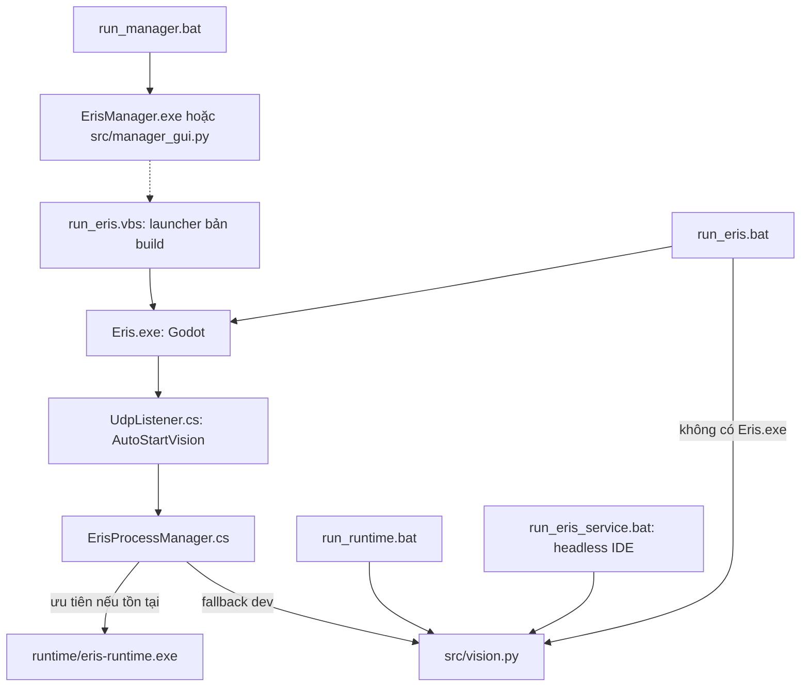
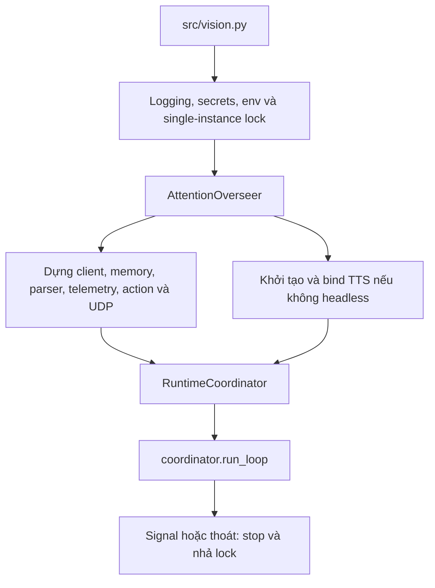

# Các file bên ngoài quản lý Eris

Đối chiếu source ngày 18/10/2026. Phạm vi: entry point, launcher, manager,
bootstrap, cấu hình và build; không nghiên cứu lại nội bộ từng module.
Đây là đối chiếu checkout, chưa launch/stop/build bất kỳ process nào.

## Chuỗi mở ứng dụng

Hai nhánh từ ErisProcessManager là lựa chọn thay thế, không chạy cả hai.
Nhánh Python của run_eris.bat cũng là fallback khi không có Eris.exe.
Generated VBS có fallback Python tương tự. Khi khởi chạy binary đóng gói,
không suy nó trùng source hiện tại nếu chưa kiểm tra build/provenance.

## Ai quản lý ai

| File | Trách nhiệm cụ thể |
|---|---|
| `run_eris.bat` | Thiết lập interpreter/env/root/cache/state/home, kiểm secrets, mở bridge nếu có, rồi mở Eris.exe hoặc Python backend |
| `run_runtime.bat` | Mở trực tiếp src/vision.py, không mở Godot; env được thiết lập ít hơn run_eris.bat |
| `run_eris_service.bat` | Cùng entry Python nhưng bật VS Code service mode, tắt TTS và nhiều nhánh tự nói/background, dùng settings path riêng |
| `run_manager.bat` | Ưu tiên manager EXE có sẵn, sau đó chạy src/manager_gui.py |
| `src/manager_gui.py` | Tkinter control panel; mở script/EXE/VBS, sửa/cài tài khoản và mở pool UI; không phải vòng lặp chat |
| `src/body/UdpListener.cs` | Startup frontend; auto-start backend, xử lý callback crash và lên lịch restart sau 2 giây nếu bật |
| `src/body/ErisProcessManager.cs` | Sở hữu handle process Brain, start/stop/toggle, truyền environment, thu stdout/stderr và báo exit |
| `src/vision.py` | Entry point và composition root backend: config, single-instance lock, dựng dịch vụ, chạy coordinator và cleanup |
| `src/body/Live2DBodyManager.cs` | Sở hữu process renderer riêng; start/control/stop Live2D, không sở hữu vòng suy nghĩ |
| `eris_setup.py` | CLI setup/doctor/health/dependencies, portable Python, gọi build và một số service phụ |
| `run_doctor.bat` | Gọi eris_setup.py; không chỉ là một kiểm tra read-only tự động |
| `_fullbuild.py` | Copy/package source/runtime assets và sinh launcher cho output; có profile dev/release |
| `_patchbuild.py` | Chuẩn bị gói cập nhật; không phải thành phần chạy chat |

Manager GUI dùng subprocess.Popen để mở công cụ. Không thấy nó theo dõi các
handle đó để làm process supervisor chung. Sở hữu process Brain thuộc C# manager;
restart policy nằm ở UdpListener. Trong eris_setup.py, stop_all chỉ terminate
các process thuộc danh sách _procs mà chính phiên setup đã start.

## src/vision.py nối hệ thống thế nào

Tên vision.py dễ gây hiểu nhầm: file này bootstrap toàn backend, không chỉ nhìn
màn hình. AttentionOverseer.run_loop chuyển quyền chạy sang coordinator.
AttentionOverseer.stop gọi coordinator.stop, process-manager.stop, TTS shutdown
và cleanup WebAI/DS2API child process do nó đã start. Các daemon là nhánh có điều
kiện: feature flag, file tồn tại và health check; không mặc định mọi service đều bật.

## Các file hỗ trợ bên ngoài

| File | Vai trò |
|---|---|
| `eris_secrets.py` | Chọn secrets path/version, nạp .env, đọc secret/config và materialize env; không cần đọc giá trị key để lập sơ đồ |
| `secret_versions.py` | Manifest active version, stage/activate/rollback secret có kiểm tra |
| `app_logging.py` | Root logger, category, secure redaction và lọc noise |
| `guard_config.py` | Cấu hình chế độ của nhóm guard tương thích; không phải process manager |
| `semantic_authority.py` | Policy semantic authority; đọc RuntimeSettingsStore, không là entry point |
| `failure_meta.py` | Contract/chuẩn hóa metadata lỗi |
| `sender.py` | Công cụ gửi UDP Hello World khi chạy trực tiếp, không bootstrap Eris |
| `setup_secrets.bat` | Tạo secrets.json từ example nếu thiếu rồi mở editor |
| `run_deepseek_pool_ui.bat`, `run_elevenlabs_pool_ui.bat` | Mở UI đã chạy hoặc start service UI tương ứng nếu chưa lên |
| `project.godot`, `Eris.csproj` | Cấu hình frontend Godot và build C# |
| `ErisManager.spec` | PyInstaller entry src/manager_gui.py cho manager EXE |
| `build_dev_fast.bat`, `build_release_clean.bat` | Gọi _fullbuild.py với profile dev/release |
| `run_build.py` | Wrapper gọi _fullbuild.py và tự trả lời prompt; không là runtime launcher |

## Phân biệt bản source và bản build

- Launcher hiện tại và default C# VisionScriptPath đều trỏ src/vision.py.
  Root vision.py có nội dung khác (SHA-256 khác); không xem hai bản là tương đương.
- _fullbuild.py copy cây src và sinh run_eris.bat/run_eris.vbs cho output.
  Vì vậy launcher được sinh trong bản build khác launcher checkout hiện tại.
- Manager action Start Eris hiện trỏ run_eris.vbs. File đó không tồn tại ở root
  checkout lúc kiểm tra; _can_run sẽ báo missing. Build có code sinh file này.
  Không kết luận launcher trong bản portable cũng thiếu file.
- app_logging.py và eris_secrets.py ở root/src đang trùng hash. Không áp điều
  này sang vision.py hoặc mọi helper khác nếu chưa đối chiếu.

Các kết luận trên chỉ cần đọc source và kiểm tra path/hash; không chạy launcher,
không mở secret payload, không rebuild và không thay đổi cấu hình/runtime.

## Cập nhật 30/10/2026: dọn payload và bỏ sidecar Cline cũ

Theo yêu cầu dọn repo/bản dev, đã bỏ nhánh cài, deploy, health check và tự mở
`cline-bridge` khỏi `_fullbuild.py`, `eris_setup.py`, root `run_eris.bat` và VBS
được sinh. Thay mô tả lịch sử “mở bridge nếu có” ở bảng launcher phía trên:
launcher hiện không khởi chạy Cline, kể cả khi artifact cũ còn trên đĩa.
Source runtime hiện không có client Cline; không thay agent harness hoặc routing.

Full/patch build dùng chung bộ lọc `build_payload.py`: không copy `node_modules`,
`__pycache__`, cache test/lint, `src.zip`, patch/diff, `.bak` và `.tsbuildinfo`.
Giữ source/test cần cho dev cùng model MiniLM tại
`src/paraphrase-multilingual-MiniLM-L12-v2/`. Bỏ deploy bản model thứ hai ở root;
`.env.example` đã khớp đường MiniLM đang dùng ở `.env` local. Các profile custom
cần tự giữ model mà chúng cấu hình; không suy từ lần dọn này rằng Qwen bị bỏ
khỏi khả năng của embedding provider.

Đã đồng bộ riêng `eris_setup.py` và tái sinh `run_eris.vbs` trong
`C:/Users/Gtvkun/Documents/eris`, không chạy full build để tránh copy lại state,
memory hoặc account DB trong lúc dọn. Hai EXE manager/setup cũ vẫn được giữ;
thiếu `ErisManager.spec` nên không coi chúng là binary được build mới.

## Cập nhật 30/10/2026: Dọn dẹp repo diện rộng và thống nhất source of truth

Theo yêu cầu dọn dẹp các tài liệu ít đọc và chức năng/file lỗi thời:
- **Thống nhất mã nguồn `src/`:** Đã loại bỏ các file helper trùng lặp ở thư mục gốc (`app_logging.py`, `eris_secrets.py`, `failure_meta.py`, `guard_config.py`, `secret_versions.py`, `semantic_authority.py`, `sender.py`) và bản cũ `vision.py` ở root (21KB). `src/vision.py` (28KB) là entry point duy nhất. Cập nhật test `test_v66_native_expression_commitment.py` trỏ trực tiếp `src/vision.py`.
- **Dọn patch, diff, log và manifest cũ:** Đã xóa `CHANGES_V2.diff`, `eris_richchat_changes.patch`, `production_hooks.diff`, `@AutomationLog.txt`, `feat003_full.txt`, `AI_EXPORT_README.txt`, cùng các file manifest/SHA đã merge (`MANIFEST.json`, `MANIFEST_SHA256.txt`, `PATCH_MANIFEST.json`, `RECONSTRUCTION_MANIFEST.json`, `ERIS_UI_PATCH_*.txt`).
- **Dọn tài liệu thuyết trình & báo cáo tạm:** Đã xóa 11 file `README_*.md` lẻ ở root và script `build_eris_docx.py`. Xóa 292 file ảnh/xml trích xuất tạm trong `docs/reports/live2d-rig-work/source-extracted` và `docs/reports/live2d-audit-20261014`.
- **Dọn script tính năng cũ:** Xóa các script liên quan đến Google Gemini browser login cho Curiosity Tutor (`tutor_login.bat`, `tutor_login.py`, `setup_tutor_browser.bat`), wrapper `run_build.py`, script `tools/package_v4.py` và `tools/test_gemini_web_ping.py`.
- Giữ nguyên container và service `gemini_vision_docker` đang chạy phục vụ vision.

