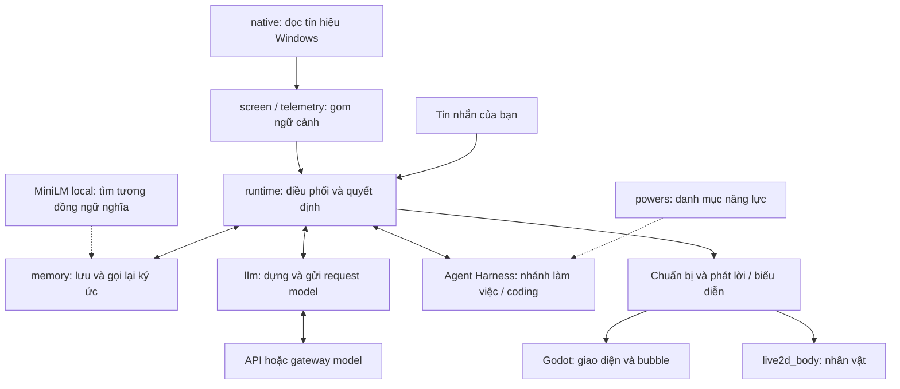
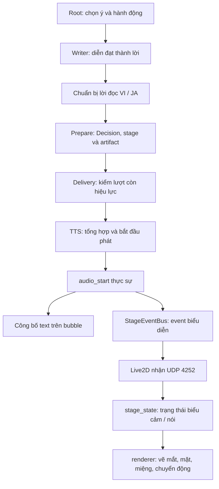
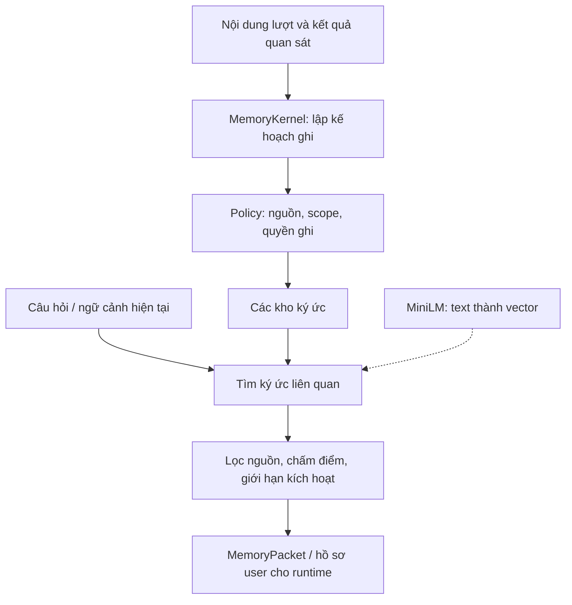
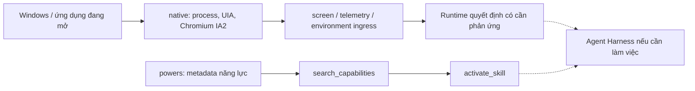

# Bản đồ các module tham gia Eris runtime

Đối chiếu source checkout ngày **18/10/2026**. Phạm vi là các thư mục trong ảnh:
`live2d_body`, `llm`, `logs`, `memory`, `models`, `native`,
`paraphrase-multilingual-MiniLM-L12-v2`, `parser_grounding`, `patches`, `powers`,
`research`. Chỉ nghiên cứu vai trò runtime, không audit benchmark/test.

Mũi tên mô tả kết nối có trong code; không xác nhận process portable đang bật
tất cả kết nối. Nét đứt là nhánh tùy cấu hình hoặc đường có giới hạn ghi kèm.
Không gọi model, nạp trọng số, đọc clipboard, bật monitor hay mở renderer.

## 1. Tổng thể

Hai ô Godot/Live2D là đích giao diện; thời điểm mở miệng và công bố text được
thể hiện riêng ở sơ đồ tiếp theo. `runtime`, `screen`, `telemetry` được đưa vào
để giải thích các đường nối, dù không nằm trong ảnh.

Điểm khởi tạo chính: `src/vision.py`, `AttentionOverseer.__init__` dựng
RemoteModelProcessManager, LlmService, MemoryCognitionCore, DecisionParser,
TelemetryService và RuntimeCoordinator; sau đó bind TTS. `build_client()` hiện
chỉ dựng remote client, không khởi động local chat model.

## 2. Đường nói và Live2D

Đây là luồng một câu cần phát tiếng khi text-audio sync bật. Event chuẩn bị/
thinking/affect vẫn có thể cập nhật trước `audio_start`. Audio done/cancel/failed
dừng trạng thái nói theo owner của câu; không cần chờ đọc xong mới hiện text.

### live2d_body

- `main.py`, `config.py`: entry point và model/window/UDP settings.
- `udp_receiver.py`: nhận stage/control, gửi ACK và thông tin cửa sổ; cổng mặc
  định 4252, tách Godot 4242 và Brain inbound 4243.
- `stage_state.py`: giữ state thread-safe, deduplicate event, theo dõi lượt đang
  phát, trộn affect nền, emotion/motion của câu và idle.
- `speech_animation.py`: animation phục vụ lời nói; `gaze.py`, `idle.py`,
  `affect.py`: mắt, vi chuyển động và affect.
- `asset_playback.py`, `parameter_profile.py`, `layer_visibility.py`,
  `renderer.py`, `window_bridge.py`: asset/parameter, render và cửa sổ Windows.

Godot `src/body/Live2DBodyManager.cs` có đường launch binary đóng gói hoặc
`python -m live2d_body.main`. `runtime/stage_event_bus.py` mirror trực tiếp event
đến Live2D theo cấu hình. Renderer không bắt buộc chỉ nhận event qua Godot.
Live2D biểu diễn nội dung đã chọn; không là một LLM hay semantic authority.

### llm

Đây là hạ tầng gọi model; quyết định lifecycle/ý của lượt nằm trong runtime.

| Nhóm | Vai trò |
|---|---|
| `process_manager.py` | Dựng client theo role và cấu hình: executive, surface, observer, inner, curator, coding... |
| `client.py`, `deepseek.py` | Transport OpenAI-compatible/Gemini, payload provider và thinking |
| `deepseek_workers.py` | Worker role, giới hạn actor và contract JSONL |
| `key_pool.py`, `provider_errors.py` | Lease key, cooldown/circuit và phân loại lỗi |
| `service.py`, `contracts.py`, `json_sanitizer.py` | Facade, hợp đồng output, trích/chuẩn hóa dữ liệu |
| `token_budget.py`, `token_pressure.py`, `prompt_compaction.py` | Ngân sách context/output và áp lực token |
| `raw_trace.py`, `raw_trace_store.py` | Quan sát request/response và role |

Có file/client cũ không có nghĩa mọi đường đều được gọi. Ví dụ local style lane
cũ đi qua feature flag; một role được build cũng chưa chứng minh nó chạy mỗi lượt.
Không dùng tên model mặc định để khẳng định model/thinking thực tế của process.

### parser_grounding

`DecisionParser` trong `service.py` bọc `ParserGroundingMixin` trong `decision.py`:
đọc/repair JSON, chuẩn hóa field, motion/action/performance và tạo `Decision`.
Call site còn có trong delivery adapter và nhánh typed discourse của orchestrator.

Nhánh delivery có PreparedPublicOutput đọc Decision đã prepare trực tiếp;
nhánh chưa có artifact gọi parser. Không vẽ parser như cổng bắt buộc gọi lại cho
mọi lượt. Tên grounding ở đây không thay thế việc kiểm nguồn/receipt; bằng chứng
fact/action còn thuộc evidence/source-grounding và các contract của runtime.

## 3. Đường trí nhớ

### memory

- `MemoryKernel`: facade ingest, query/answer, packet, maintenance và user memory.
  Bootstrap bọc MemoryCognitionCore hiện có bằng `from_existing_core`.
- `MemoryCognitionCore`: quản lý stores, commit serialize và retrieval engine.
- Các store chính: episodic, semantic, relational, affective residue, procedural,
  repair; có event ledger, active state và các store long-term tương thích.
- `memory_retrieval_engine.py` nối candidate → admission → scoring → activation
  → working-memory gate → packet. Không phải tìm gần nghĩa xong đưa mọi thứ vào prompt.
- `memory_query_*`: compile truy vấn thành IR, execute và chọn surface trả lời.
  `MemoryKernel.answer` có nhánh trả lời xác định khi đủ điều kiện; parser LLM
  nếu được dùng chỉ cung cấp IR, không có quyền tự bịa public memory answer.
- `living_user/`: facts/episodes, profile, context compiler, curator, provenance,
  giải thích/sửa/quên. Dùng lại semantic/episodic truth.
- `subject/`: SubjectRepository SQLite cho event và projection Subject Core;
  khác các JSON store của memory facade.

Một số file ngắn chỉ re-export store từ `canonical_long_term.py`; không phải mỗi
tên file đều là một pipeline độc lập. Dữ liệu runtime không mặc định nằm trong
source: `vision.py` dựng memory root qua ErisHome rồi đặt ERIS_MEMORY_CORE_DIR.

### paraphrase-multilingual-MiniLM-L12-v2

Đây là trọng số/tokenizer embedding, không là model tạo lời chat. Config trong
thư mục mô tả BertModel, hidden size 384. `memory/embedding_index.py` có singleton
lazy-load chung; khi không chỉ định model khác, ưu tiên thư mục local này.
Khi embedding bị tắt/không khả dụng, memory có đường scoring lexical fallback.
Nếu ERIS_EMBEDDING_MODEL được đặt, không mặc định lấy MiniLM local.

## 4. native và powers

### native

Đường production tìm thấy: ProcessResolver → screen/telemetry;
UIAEventClient → WindowsUIAReader; ChromiumAccessibilityAdapter → telemetry và
environment ingress scheduler. IA2 ưu tiên cho Chromium, UIA là fallback.

ClipboardMonitor, FilesystemMonitor, WindowsEventBroker, MediaMonitor,
OwnedTerminalSession, UIASemanticAdapter và UIAccessBrokerClient có implementation,
nhưng trong lần quét source Python ngoài native/tests/tools/experiments chưa thấy
caller production trực tiếp cho các class này. Vì vậy không khẳng định toàn bộ
native monitors đều được bật chỉ từ việc thấy thư mục tồn tại.

### powers

Coordinator có đường dựng AgentHarness với `src/powers` khi có dedicated coding
client. CapabilityDiscovery quét metadata; SkillLoader cần SKILL.md khi activate.
Có 8 mục: agent-self-awareness, coding-debug, coding-inspection,
coding-modification, coding-verification, desktop-awareness, safe-recovery,
workspace-navigation. Metadata chứa mô tả/tool ID/risk/mode, không tự thực thi tool.

**Kiểm tra offline hiện tại:** discovery tìm 8 mục; cả 8 thiếu SKILL.md và gọi
activate_skill đều trả `Error: SKILL.md not found`. Đây là giới hạn kích hoạt
các power này trong checkout, không kết luận mọi tool/coding path đều hỏng.

## 5. Các thư mục không đưa vào lõi sơ đồ

| Thư mục | Vai trò từ source hiện tại |
|---|---|
| `logs` | Dữ liệu observability. Writer ở `runtime/observability.py`, đường dẫn có cấu hình; file dưới src/logs không chứng minh log của process đang chạy |
| `models` | Hiện chỉ có social_intent_head.json, bảng phân loại intent nhỏ; không tìm thấy production Python loader tham chiếu tên asset này |
| `patches` | Hai file diff MemoryPanel/backend lưu sẵn; không tìm thấy production Python caller áp dụng chúng lúc chạy |
| `research` | JSONL mẫu/rating/prediction cho nghiên cứu social; không tìm thấy production caller cho các sample đã quét |

Không coi kết quả tìm kiếm âm tính là bằng chứng asset chưa từng được sử dụng
trong script ngoài repo, cấu hình động hay một phiên lịch sử.

## Bằng chứng và giới hạn

Đã đọc entry point, constructor/call site, contract liên quan và quét tham chiếu
Python production. Đã chạy probe thuần offline discovery/activation powers;
không chạy toàn test suite vì mục tiêu là lập bản đồ source, không sửa hành vi.
Các sơ đồ là bản đồ kiến trúc checkout, không phải trace phiên portable live.

Nguồn chính: `src/vision.py`, `src/runtime/coordinator.py`,
`src/runtime/coordinator_bootstrap.py`, `src/runtime/conversation/runtime_writer.py`,
`src/runtime/conversation/delivery_adapter.py`,
`src/runtime/conversation/public_output_artifact.py`,
`src/runtime/public_output_runtime.py`, `src/runtime/stage_event_bus.py`,
`src/body/Live2DBodyManager.cs` và các package được mô tả ở trên.
