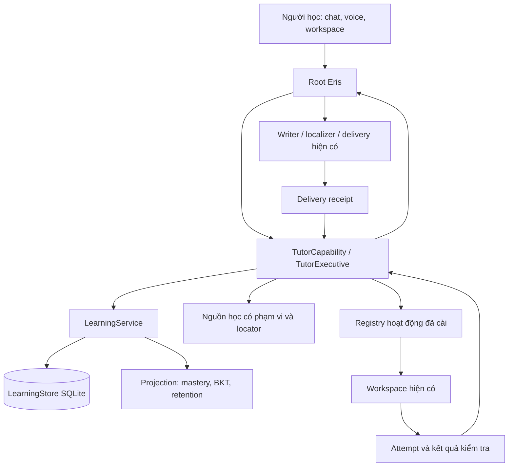

# Eris Tutor — nghiên cứu mã nguồn mở và quyết định tích hợp

Ngày đối chiếu: **31/10/2026**. Phạm vi: bản ghi user gửi, source Eris hiện tại và **16 repo bên ngoài**.
Đây là **đề xuất thiết kế sau nghiên cứu**, chưa phải các tính năng đã triển khai.

Cập nhật **01/11/2026**: phần tích hợp v1 đã được triển khai và kiểm tra trong source;
xem [báo cáo triển khai và giới hạn kiểm chứng](2026-11-01-tutor-open-source-integration-v1.md).
Các nhận xét “hiện tại/chưa có” bên dưới giữ mốc nghiên cứu 31/10; báo cáo mới thay
thế trạng thái lịch sử cho những phần được ghi rõ là đã triển khai.

## 1. Quyết định chính

Tiếp tục xây Tutor như một năng lực của Eris, trên **LearningService hiện có**.
Chọn một số cơ chế nhỏ, có ranh giới và đo được hiệu quả:

1. **Theo sát DeepTutor:** học cách lưu lần làm bài thống nhất, sửa chương trình học có revision và giữ liên kết tới nguồn.
2. **Dùng py-fsrs qua adapter:** thay lịch ôn heuristic khi đã có dữ liệu recall phù hợp; tách việc nhớ lại khỏi mức hiểu.
3. **Học OATutor và Oppia:** gợi ý theo bậc, phản hồi theo lỗi cụ thể, rubric gắn với kỹ năng.
4. **Dùng Docling như bộ nhập liệu tùy chọn; học Open Notebook về phạm vi tìm kiếm:** giữ nguồn đến trang/đoạn, không mang cả ứng dụng thứ hai vào Eris.
5. **Mở workspace theo hoạt động:** MathLive/JSXGraph cho toán; Pyodide cho Python nhẹ; tận dụng Docker workspace sẵn có cho bài cần môi trường đầy đủ.
6. **pyBKT, pyKT và DSPy phục vụ đánh giá offline trước:** không biến chúng thành điều kiện bắt buộc của mỗi lượt chat.

Learning Universe là cách nhìn và thao tác trên những dữ liệu này. Chưa cần một hệ cơ sở dữ liệu graph, một nhóm agent hay một scheduler nền riêng cho từng cơ chế.

## 2. Eris thực sự đã có gì

Đọc source tại HEAD `a6d7526db35e20366e677db2823872f3d1c18321`, có thay đổi cục bộ đang dở.
Các nhận xét dưới đây là đối chiếu source; không xác nhận bản portable đang chạy đã dùng đúng checkout.

| Nền hiện có | Bằng chứng trong Eris | Ý nghĩa khi tích hợp |
|---|---|---|
| Kernel đã lấy ý tưởng từ DeepTutor ở mốc `ef2d9e5c` | [notice](../../src/THIRD_PARTY_NOTICES.md), [package](../../src/runtime/learning_core/__init__.py) | Nghiên cứu phần upstream mới có ích hơn port lại kernel |
| LearningService + SQLite + transaction chứa evidence/mastery/review/belief | [service](../../src/runtime/learning_core/service.py), [store](../../src/runtime/learning_core/store.py) | Giữ một nơi có quyền commit sự thật học tập |
| TutorExecutive / RuntimeTutorReasoner và composition root | [composition](../../src/runtime/tutor/composition.py), [executive](../../src/runtime/tutor/executive.py) | Mở rộng intelligence đang có, không tạo executive khác |
| TutorCapability chỉ trả advice/evidence, receipt mới xác nhận câu hỏi đã giao | [capability](../../src/runtime/capabilities/tutor.py) | Workspace phải nối cùng lifecycle này |
| BKT shadow, tự nhận chưa calibrated | [belief_model](../../src/runtime/learning_core/belief_model.py) | Không gọi nó là xác suất năng lực đã kiểm nghiệm |
| D/S/R và lịch ôn heuristic, tự ghi rõ chưa phải FSRS | [review_memory](../../src/runtime/learning_core/review_memory.py) | Có điểm thay thế rõ ràng cho adapter FSRS |
| Auto-path sinh 3–8 knowledge point; builder có sắp thứ tự theo prerequisite và từ chối cycle | [auto_path](../../src/runtime/tutor/auto_path.py), [builder](../../src/runtime/pedagogical_plan_builder.py) | Không cần viết lại bộ tạo chương trình học từ đầu |
| Root nhận learner projection có giới hạn; capability nằm trong registry | [context](../../src/runtime/conversation/context_assembler.py), [orchestrator](../../src/runtime/ai_orchestrated/orchestrator.py) | Không đổ toàn bộ learner ledger vào prompt |
| Artifact protocol + feedback và Docker Python workspace | [protocol](../../src/runtime/workspace/artifact_protocol.py), [Docker](../../src/runtime/workspace/python_docker.py) | Tái dùng contract; chưa cần thêm hệ truyền artifact |
| Curiosity Tutor / research relay riêng | [wiring](../../src/runtime/tutor_wiring.py), [research evidence](../../src/cortex/tutor/research_evidence.py) | “Eris tự nghiên cứu” khác “đánh giá người học” |

Hai chỗ cần làm rõ trước khi mở rộng:

- `knowledge_points` hiện có khóa chính `kp_id` và một `path_id`; mastery/review cũng theo `kp_id`. Chưa phải mô hình kỹ năng dùng chung nhiều lộ trình có version và namespace. ID ngắn do model đặt không nên thành danh tính kỹ năng toàn cục.
- `commit_evidence` đã có `hint_count`, nhưng `TutorExecutive._apply_semantic_assessment` trong đường đã đọc không truyền giá trị đó. BKT đếm các family theo interaction/turn, chưa mô hình hóa rõ mức trợ giúp. Vì vậy không suy “family khác nhau” thành “tự làm độc lập”.

**Đính chính cho bản khung trước:** curriculum, evidence, BKT và review không còn là những ô hoàn toàn chưa có trong Eris. Công việc tiếp theo là chuẩn hóa và mở rộng các phần này. Bản nghiên cứu này không xác nhận các ngày công bố hay số phần trăm hiệu quả sản phẩm trong văn bản user dán; chúng không được dùng làm cơ sở chọn dependency.

## 3. Ma trận 16 repo

“Dùng” dưới đây là lựa chọn cho bước triển khai kế tiếp, chưa phải dependency đã được cài.
Mức đọc khác nhau được ghi rõ; README không được coi là chứng minh chất lượng production.

| Repo | Đã xem | Phần phù hợp | Quyết định / giới hạn |
|---|---|---|---|
| [HKUDS/DeepTutor][deep] | README, assessment, lesson evidence, outline revision, objective relations | Attempt ledger, revision có diff, source-bound lesson | **Ưu tiên học thiết kế và port chọn lọc**; Apache-2.0 |
| [open-spaced-repetition/py-fsrs][fsrs] | README, scheduler, pyproject | Lịch ôn, Card/ReviewLog, UTC, serialization | **Dependency nhỏ nên dùng**; MIT; optimizer là extra |
| [CAHLR/pyBKT][bkt] | README và ví dụ API trong README | Fit/evaluate BKT; phân biệt prior/guess/slip/learn | **Công cụ offline**, không thay BKT đang chạy ngay; MIT; Windows có giới hạn bản C++ |
| [pykt-team/pykt-toolkit][pykt] | README và mô tả benchmark | Chuẩn hóa preprocessing và so sánh deep KT | **Để sau khi đủ dữ liệu**; MIT; PyTorch không cần nằm trên chat path |
| [CAHLR/OATutor][oat] | README, BKT-brain, HintSystem | Gợi ý tăng dần, scaffolding, bài tập gắn kỹ năng | **Học sư phạm và contract bài tập**; MIT code; content repo cần xét riêng |
| [oppia/oppia][oppia] | skill_domain và metadata repo | Skill có misconception, rubric, prerequisite | **Học domain model**, không kéo Python/Angular/App Engine stack; Apache-2.0 |
| [h4ksclaw/learnharness][harness] | README, architecture, BKT, FSRS wrapper | Ví dụ ghép FSRS+BKT+graph theo môn | **Chỉ tham khảo**: chưa thấy license trong tree đã đọc; có điểm cần tránh ở §4 |
| [docling-project/docling][docling] | README, pyproject, tài liệu ProvenanceItem | Đọc tài liệu thành cấu trúc với page/bbox/charspan | **Adapter nhập liệu tùy chọn**; MIT code, model weights có license riêng |
| [lfnovo/open-notebook][notebook] | README, ADR scope search, hướng dẫn citation | Workspace chứa nguồn, note; lọc theo notebook ngay trong query | **Học tổ chức và retrieval**, không mang SurrealDB/LangGraph/app riêng vào Eris; MIT |
| [TerraByte-Dev/OpenEdu][openedu] | README, curriculum.ts, license content | Sinh chương trình nhiều bước có schema, concept ledger | **Học pipeline và continuity**; không áp 6 cấp cho mọi môn; MIT code, content có điều khoản riêng |
| [arnog/mathlive][mathlive] | README, metadata | Nhập công thức bằng web component | **Module toán nên dùng khi có web workspace**; MIT; không phải bộ chứng minh toán |
| [jsxgraph/jsxgraph][jsx] | README, LICENSE.MIT | Đồ thị/hình học có kéo thả | **Module trực quan nên dùng khi cần**; có lựa chọn MIT, dù metadata API nhận diện LGPL |
| [pyodide/pyodide][pyodide] | README, metadata | Chạy Python/scientific packages bằng WebAssembly | **Runtime tùy chọn cho bài nhẹ**; MPL-2.0; WebAssembly không tự tạo ranh giới tin cậy |
| [codesandbox/sandpack][sandpack] | README, FAQ chính thức | Editor và preview JavaScript trong browser | **Hoãn dependency mặc định**; Apache-2.0 cho toolkit, Nodebox có license/EULA và nhu cầu mạng riêng |
| [H5P/h5p-php-library][h5p] | README.txt, metadata | Đóng gói hoạt động tương tác qua interface | **Chỉ học ý tưởng activity package**; PHP core GPL, quá nặng cho nhu cầu hiện tại |
| [stanfordnlp/dspy][dspy] | README, metadata | Tách chương trình model thành module, tối ưu có metric | **Thí nghiệm offline sau**, MIT; không cần đưa framework vào Root |

Không chọn theo số sao. Các tiêu chí là: khả năng dùng riêng một phần, dữ liệu giữ được khi đổi thư viện, độ phù hợp Python/Windows/Godot, chi phí vận hành và bằng chứng về hành vi.

## 4. Những cơ chế đáng lấy, và lấy đến đâu

### 4.1. DeepTutor: lần làm bài và sửa lộ trình đáng tin hơn thêm nhiều mode

Upstream hiện có adapter assessment dùng chung giữa nhiều learning surface, lưu attempt và metadata như hints, response time, quality, linkage tới knowledge point. `outline_revision.py` tính diff và state digest bằng code; `objective_relations.py` kiểm ID, nguồn và cycle. [Nguồn assessment][deep-assessment], [outline][deep-outline], [relations][deep-relations].

Đưa vào Eris ba nguyên tắc:

- Mọi câu trả lời ở chat, đồ thị, editor hay voice đi qua cùng một `AssessmentAttempt`; đổi giao diện không tạo một hệ mastery mới.
- Sửa lộ trình bằng proposal có base revision và diff. Commit phải kiểm revision còn đúng; đổi thứ tự không đổi danh tính kỹ năng.
- Nguồn của bài giảng phải tồn tại và được kiểm tra độc lập với model. Upstream phân biệt kiểm identity/quotation với đánh giá tính phù hợp của model; điều thứ hai không chứng minh kiến thức đúng. [lesson evidence][deep-lesson].

Giới hạn cần giữ: objective relations trong chính file upstream được mô tả là metadata cấu trúc, **chưa tự gate học hay retrieval trong slice đó**. Không mặc định upstream đã giải xong adaptive curriculum.

Không thay nguyên runtime Eris bằng DeepTutor. Identity, Root, writer, localization và TTS vẫn do Eris sở hữu.

### 4.2. FSRS: nên dùng thư viện thật, với log thật

Py-fsrs có Card, Rating, ReviewLog, lịch theo UTC và JSON serialization. Scheduler có fuzz mặc định; thư viện nền chỉ cần `typing-extensions` tại snapshot đã đọc, còn optimizer kéo thêm torch/numpy/pandas. [README][fsrs], [scheduler][fsrs-code], [package][fsrs-package].

Đề xuất một adapter retention trong learning core:

- Nhận `review_item_id`, trạng thái card, kết quả recall đủ điều kiện, thời điểm UTC và phiên bản scheduler/config.
- Trả card mới, due time và review log; không ghi SQLite và không gọi model.
- LearningService commit attempt, review log và projection trong cùng transaction.
- Truyền thời điểm rõ ràng; tắt fuzz trong replay/shadow ban đầu. Nếu sau này bật jitter, lưu kết quả hoặc cơ chế tái lập rõ ràng.
- Cần giữ nguyên Card ID khi lưu/mở lại. Lưu raw ReviewLog để đổi phiên bản và đánh giá được.

Quy tắc rating phải đúng nghĩa: **Again là không nhớ; Hard là vẫn nhớ nhưng khó**. Trả lời sai không được biến thành Hard để giữ streak. Trả lời sau khi đã xem đáp án không được coi là recall độc lập. Lượt có hint vẫn lưu attempt, nhưng không dùng như Good/Easy độc lập.

FSRS dự đoán khả năng nhớ một review item, không thay BKT/mastery và không kết luận người học vận dụng tốt. Một kỹ năng có thể có nhiều prompt ôn; khi mở rộng cần `review_item_id` riêng, thay vì ép mọi card vào duy nhất một row theo `kp_id`.

Không gán trực tiếp stability heuristic cũ thành trạng thái FSRS đã được fit. Ưu tiên khởi tạo thận trọng hoặc replay chỉ những log có semantics tương thích. Chạy shadow trước khi scheduler mới sở hữu due time.

### 4.3. OATutor + Oppia: biết sai ở đâu, gợi ý đến mức nào

OATutor có hệ hint/sub-hint và bộ cập nhật BKT tách khỏi UI. Oppia biểu diễn skill cùng rubric, misconception và prerequisite. [hint system][oat-hints], [BKT][oat-bkt], [skill domain][oppia-skill].

Áp dụng trong Eris:

1. Mỗi hoạt động có objective, rubric và tiêu chí tự kiểm chứng.
2. Hint đi từ nhắc hướng → chỉ ra khái niệm liên quan → bước trung gian → ví dụ tương tự → lời giải khi phù hợp.
3. Ghi `hint_count`, mức trợ giúp lớn nhất và `answer_revealed` ở nguồn phát hint, không để model đoán lại từ hội thoại.
4. Sau khi được giúp, cho một câu/bài biến thể để kiểm khả năng tự làm.
5. Misconception là giả thuyết có evidence refs, phản ví dụ và trạng thái; cho user phản đối/sửa.

Không sao chép cơ chế phạt người học vì xin hint. Dữ liệu trợ giúp dùng để diễn giải bằng chứng và chọn bước tiếp theo. Cũng không bắt Eris luôn hỏi Socrates: người mới có thể cần ví dụ mẫu; người đang gấp có thể cần giải thích trực tiếp.

### 4.4. pyBKT / pyKT: đo mô hình trước khi thay mô hình

Eris đã có BKT shadow với prior mặc định, discount theo family và cờ chưa calibrated. pyBKT hữu ích để fit/so sánh các biến thể thay vì tự tin rằng bộ tham số mặc định phù hợp mọi môn. README phân biệt đường Python và C++; bản C++ trên Windows không được upstream xác nhận như các nền tảng khác. [pyBKT][bkt].

Giữ inference nhẹ hiện tại; xuất dataset đã giảm dữ liệu cá nhân cho evaluation offline khi có đủ sự kiện. So sánh baseline tỷ lệ đúng theo kỹ năng, BKT hiện tại và mô hình fit. Ưu tiên log loss/Brier/calibration cùng với AUC. Chia theo người học hoặc theo thời gian đúng mục tiêu triển khai; tách item family để tránh cùng một đề đổi số lọt cả train và test.

pyKT có giá trị ở quy trình benchmark deep knowledge tracing, nhưng cần chuỗi tương tác và dữ liệu phù hợp. Hiệu quả trên dataset công khai không chứng minh hiệu quả trên một người học Eris. Chưa có lý do đưa deep KT vào runtime. [pyKT][pykt].

### 4.5. Nguồn học: Docling để trích xuất, Open Notebook để học cách khoanh phạm vi

Docling có cấu trúc provenance gồm trang, bounding box và character span; giữ chúng có ích hơn chỉ đưa PDF qua model rồi lưu bản tóm tắt. Điều này không bảo đảm OCR/công thức luôn đúng. [ProvenanceItem][docling-prov].

Open Notebook chọn thêm scope vào query search hiện có. ADR giải thích vì sao lọc sau LIMIT làm mất kết quả phù hợp. Eris nên áp scope **trước ranking/limit** cho cả lexical và vector search. [ADR-008][notebook-scope].

Tuy nhiên hướng dẫn citation của Open Notebook nói reference hiện trỏ tới cả source/note/insight, không có page/section/highlight. Không lấy citation đó làm lời hứa về nguồn tới từng đoạn. [citations][notebook-cite].

Trong Eris, mỗi `SourceSpan` nên chứa source ID, content hash/version, locator, đoạn trích, parser version và thời điểm nhập. Chỉ dùng page/bbox nếu định dạng/parser thật sự cung cấp; HTML có section/offset, video có timestamp. Tách **tài liệu gốc**, **note của user** và **tóm tắt model** bằng loại nguồn.

Khi nguồn mâu thuẫn, giữ cả hai cùng phạm vi/thời điểm, hạ mức khẳng định và có thể hỏi user chọn tài liệu chuẩn. Tài liệu đã thay phiên bản phải làm citation cũ thành stale rõ ràng, không âm thầm trỏ sang nội dung mới. Thiếu nguồn thì Eris vẫn có thể giải thích từ tri thức nền nhưng phải thể hiện đúng nguồn gốc; không tạo citation giả.

### 4.6. Workspace: chọn hoạt động, rồi chọn renderer

Một hoạt động toán có thể chỉ cần nhập công thức MathLive; hình học/đồ thị cần JSXGraph. Python đơn giản có thể dùng Pyodide, còn bài cần môi trường đầy đủ tái dùng Docker workspace Eris. [MathLive][mathlive], [JSXGraph][jsx], [Pyodide][pyodide].

Registry nên mô tả capability thực tế như `math_input`, `graph_manipulation`, `python_exec`, `test_execution`; Tutor chọn theo objective, renderer đã cài, readiness và ngân sách. Hệ thống không cần tạo một “app” mới cho từng môn.

Activity gửi event có `activity_id`, `interaction_id`, `attempt_id`, revision và dữ liệu thao tác. Có thao tác/preview đúng chưa đủ thành learning evidence: assessor/rubric cần xác định phần nào chứng minh kỹ năng. Test xanh chỉ chứng minh artifact qua các test đó; nếu Eris viết hộ code thì không chứng minh người học tự làm.

Pyodide cho Python truy cập Web APIs, nên Worker chỉ giúp tách luồng chạy, không tự đủ để cô lập mã. Nếu triển khai cần origin/iframe riêng, quyền giao tiếp hẹp, timeout và khả năng terminate. Kết quả từ client là dữ liệu có mức tin cậy riêng, không thành server-verified receipt chỉ vì JSON có field “passed”.

Sandpack đáng học UI editor/preview, nhưng FAQ phân biệt toolkit Apache-2.0 với Nodebox và các template có điều khoản riêng; Nodebox còn có nhu cầu tải từ dịch vụ ngoài khi khởi động. Vì vậy chưa chọn làm runtime mặc định của Eris. [FAQ][sandpack-faq].

H5P gợi ý một activity package có metadata, renderer và sự kiện chung. Chưa cần nhận PHP core và toàn bộ hệ authoring chỉ để có vài bài tương tác. [README core][h5p-readme].

### 4.7. OpenEdu và LearnHarness: gần ý tưởng, chưa phải bản mẫu để bê nguyên

OpenEdu có pipeline sinh curriculum nhiều bước, schema và concept ledger; đây là hướng tốt để không tạo mỗi lesson một lần rồi mất continuity. Nhưng cấu trúc cấp học cố định của nó là lựa chọn sản phẩm riêng. Eris nên sinh một lát học nhỏ rồi mở rộng khi có bằng chứng và nguồn, không ép mọi lĩnh vực vào cùng số cấp. Schema hợp lệ cũng không chứng minh giáo trình đúng. [curriculum][openedu-curriculum].

LearnHarness ghép đúng các từ khóa FSRS+BKT+knowledge graph. Đọc code cho thấy hai điểm cụ thể cần tránh:

- Wrapper nhận `target_retention` nhưng dựng `Scheduler()` mà không truyền giá trị này trong constructor đã xem.
- `infer_from_chat` trộn `p_mastery` với confidence do model đưa ra. Cách này không đủ để khẳng định người học đã chứng minh kỹ năng.

Đây là quan sát tĩnh ở snapshot, chưa phải lỗi đã tái hiện live. Không tìm thấy LICENSE/COPYING/NOTICE trong tree đã đọc và API không trả license; chỉ dùng làm tài liệu tham khảo ý tưởng ở vòng này. [FSRS wrapper][harness-fsrs], [BKT implementation][harness-bkt].

Không phục hồi memory ConceptGraphStore của Eris đã gỡ ngày 30/10. Prerequisite trong learning path hiện có là quan hệ sư phạm giới hạn theo domain/path; mở rộng chúng không cần graph của Self, multi-hop memory hay graph database.

### 4.8. Teaching Evolution: học cách đánh giá từ DSPy, chưa tự tối ưu live

DSPy cung cấp cách mô tả module model và tối ưu theo metric. Nó không tự cung cấp metric học tập đúng, dataset không nhiễm hay bằng chứng learner cải thiện. [DSPy][dspy].

Bước đầu chỉ cần version teaching policy, lưu move đã giao và outcome sau đó. Một biến thể giải thích tốt cần được đánh giá bằng bài tự làm sau trợ giúp, bài chuyển ngữ cảnh và delayed recall; không chỉ bằng điểm tự chấm của cùng model hay mức hài lòng tức thời.

Có thể dùng DSPy offline sau khi có benchmark thật. Không cho optimizer tự sửa Identity Core, tool authority hoặc prompt production dựa trên vài lượt hội thoại.

## 5. Kiến trúc tối thiểu đề xuất



Có ba loại evidence phải phân biệt: nguồn kiến thức hỗ trợ một claim; attempt của người học hỗ trợ đánh giá kỹ năng; receipt hỗ trợ claim hoạt động/câu hỏi đã được giao. Không gom ba loại thành một “confidence score”.

Giữ ba ranh giới:

- **Root** sở hữu quyết định hội thoại, công cụ và cá tính.
- **TutorExecutive** đề xuất cách dạy và đánh giá semantic; kết quả là dữ liệu có cấu trúc.
- **LearningService** kiểm tra/commit ledger, version và projection. Không có model call trong transaction.

Phần knowledge growth có thể tạo research job qua capability đang có; completion trả artifact về đúng session/revision. Teaching evolution trước mắt là đọc log/đánh giá offline, không thành một loop nền tự đổi policy.

## 6. Bổ sung dữ liệu gì để đủ dùng lâu dài

Đề xuất bốn contract bền vững; tái dùng các type đang có thay vì tạo một engine cho mỗi tên tính năng.

| Contract đề xuất | Dữ liệu chính | Owner |
|---|---|---|
| DomainSpec | domain ID, tên, mục tiêu, namespace/version kỹ năng, nguồn mặc định, capability phù hợp | LearningService / LearningStore |
| SourceSpan | ID tài liệu + version/hash, locator, trích đoạn, parser/provenance | Kho nguồn hiện có, được tham chiếu từ learning |
| CurriculumRevision | path ID, base revision/hash, diff, stable skill refs, lý do và source refs | LearningService |
| AssessmentAttempt | attempt/interaction/item/activity IDs, skill refs, answer ref, result/rubric, trợ giúp, verifier và provenance | LearningService |

`ActivitySpec` là payload renderer có version và tham số đã kiểm, không nhất thiết cần thêm một service/database. Kết nối nó qua artifact protocol hiện có; các kind interaction mới cần negotiation rõ ràng vì v1 hiện chỉ biết math/chart/code/table/document/speech.

Chi tiết attempt cần có:

- `result = correct | incorrect | partial | ungraded`; không ép uncertainty thành sai hoặc đúng.
- `assistance = independent | hinted | worked_with_eris | answer_revealed`.
- `item_family_id`, `rubric_version`, `assessor_version`, source refs và trạng thái tool verification.
- Timestamp của việc giao bài và nộp bài; thời gian phản hồi đã trừ khâu sinh/phát giọng khi dùng làm tín hiệu.
- `idempotency_key` cho submit/retry và `supersedes_attempt_id` hoặc correction event; sửa đánh giá không cộng thêm một bài đã làm.

Attempt có thể tham chiếu nhiều kỹ năng, nhưng một bài không tự trở thành nhiều phép thử độc lập. Quy tắc phân bổ evidence phải được version và replay được.

Domain không gắn cứng với một tool. Có thể học cùng kỹ năng qua chat hoặc editor. Việc dùng chung kỹ năng giữa path cần namespace ổn định và bảng membership, tránh clone kỹ năng rồi copy mastery. Môn mới ở lần đầu chỉ cần path nhỏ, chưa phải sinh toàn bộ ontology.

User phải xem được bằng chứng nào dẫn tới đánh giá nào, yêu cầu sửa/xóa hoặc tắt theo dõi. Ledger append-only là quy tắc ghi thông thường, không vô hiệu hóa quyền xóa: forget phải xóa/redact dữ liệu được chọn, rebuild projection và ngăn replay khôi phục lại; backup có thời hạn/phạm vi xử lý riêng.

## 7. Trình tự triển khai đã chắt lọc

| Bước | Thay đổi gọn nhất | Điều kiện hoàn thành |
|---|---|---|
| 1 — Làm chắc evidence | Thêm attempt/assistance/rubric/version; nối hint/reveal từ event thật | Chat, editor và review dùng cùng luật; retry/correction không đếm trùng |
| 2 — Nguồn + domain + revision | Thêm namespace kỹ năng, source locators, revision cho path | Một domain mới có nguồn; đổi curriculum không làm mất lịch sử hoặc ghi đè state mới |
| 3 — Retention | Cắm py-fsrs sau adapter và lưu ReviewLog/Card | Shadow replay ổn định; migration không bịa lịch ôn; switch có version rõ |
| 4 — Một lát workspace hoàn chỉnh | Chọn một môn, ví dụ Python căn bản hoặc đồ thị hàm số | Từ giao bài → thao tác → kiểm tra → evidence → quay lại chat hoạt động trọn vẹn |
| 5 — Đánh giá dạy học | So sánh chính sách hiện tại với một biến thể | Independent transfer/delayed recall cùng chi phí và latency được ghi nhận |

Đây là thứ tự kỹ thuật, không khóa mọi tính năng khác cho tới khi hoàn tất cả năm bước.
Bước 1 có thể chỉ dùng chat và bài tập hiện có. Docling/Pyodide/JSXGraph được lazy-load theo nhu cầu; thiếu module thì registry báo unavailable và chọn hoạt động khác phù hợp.

Không thêm mặc định: app DeepTutor/Open Notebook riêng, PostgreSQL/SurrealDB/Neo4j, deep KT training trên máy người dùng, agent tự tiến hóa hoặc cài tool mới từ nội dung do model sinh. Trước hết mở rộng những boundary Eris đã có.

## 8. Tiêu chí kiểm chứng trước khi gọi là tích hợp thành công

| Ca bắt buộc | Kết quả cần quan sát |
|---|---|
| Chat/research bình thường, chưa có ý định học | Không tự mở bài kiểm tra hoặc ghi mastery chỉ vì nhắc tên chủ đề |
| Hai path có kỹ năng trùng tên nhưng khác domain | Không trộn evidence; dùng chung chỉ qua skill identity đã xác định |
| Người học đúng sau hint/đã xem đáp án | Không ghi independent success; hỏi bài biến thể khi phù hợp |
| LLM không chắc / rubric thiếu | `ungraded`, không tăng mastery hoặc stability như bài đúng |
| Câu hỏi chưa được giao / audio bị preempt | Không tạo phép thử đã hoàn tất; activity nhận receipt phù hợp surface |
| Retry submit, restart và event đến muộn | Một attempt hợp lệ; event sai generation/revision không sửa lượt mới |
| Path bị sửa trong lúc job nghiên cứu đang chạy | Proposal stale bị từ chối hoặc được dựng lại từ revision mới |
| Citation sai trang, nguồn mất hoặc hash thay đổi | Không diễn giải citation cũ là nguồn hiện tại còn hợp lệ |
| Bài có nhiều kỹ năng, test xanh nhưng Eris viết hộ | Không suy thành nhiều independent successes |
| Quay lại sau nhiều tháng | Hiển thị độ chưa chắc và probe/recall; không mặc định quên hết hoặc vẫn thành thạo |
| Xóa/sửa dữ liệu học | Projection cập nhật và replay không phục hồi điều đã xóa |
| Tool tùy chọn chưa sẵn sàng | Giải thích readiness và dùng hoạt động khả dụng; không nhận đã chạy tool |
| A/B phương pháp dạy | Báo khả năng tự làm, transfer/retention, latency và token/cost; chưa có dữ liệu thì chưa tuyên bố tốt hơn |

Dùng simulated learner để tìm lỗi giao thức và tình huống biên, không coi điểm của learner model là learning gain của người thật. Với một người dùng, thí nghiệm lặp theo thời gian cũng chịu hiệu ứng thứ tự; cần nêu giới hạn này thay vì công bố phần trăm cải thiện sớm.

## 9. Kiểm chứng đã thực hiện trong vòng nghiên cứu

Đã chạy nhóm test hiện có:

```text
python -m pytest src/tests/test_root_orchestrated_learner_v1.py src/tests/test_long_term_learner_v2.py src/tests/test_learning_kernel_boundary_v4.py -q
19 passed in 1.88s
```

Nhóm này kiểm boundary kernel, một số tính chất retry/transaction, persistence và learner projection hiện tại.
**Không** chứng minh FSRS/Docling/workspace mới đã được tích hợp, chất lượng sư phạm, audio live hay deployment portable.
Vòng này chỉ thêm tài liệu nghiên cứu; không đổi code runtime, dependency hoặc dữ liệu học của người dùng.

## 10. Nguồn có thể kiểm tra lại

Manifest cạnh tài liệu lưu commit, phạm vi đọc và file evidence: [source manifest](2026-10-31-tutor-open-source-sources.json).
Các link code dưới đây ghim vào commit quan sát được; các repo chỉ đọc README được phân biệt với repo đã đọc implementation.

[deep]: https://github.com/HKUDS/DeepTutor/blob/1ea7df155447f4caf0e3abc86b3ff5395479cd4a/README.md
[deep-assessment]: https://github.com/HKUDS/DeepTutor/blob/1ea7df155447f4caf0e3abc86b3ff5395479cd4a/deeptutor/learning/assessment.py
[deep-outline]: https://github.com/HKUDS/DeepTutor/blob/1ea7df155447f4caf0e3abc86b3ff5395479cd4a/deeptutor/learning/outline_revision.py
[deep-relations]: https://github.com/HKUDS/DeepTutor/blob/1ea7df155447f4caf0e3abc86b3ff5395479cd4a/deeptutor/learning/objective_relations.py
[deep-lesson]: https://github.com/HKUDS/DeepTutor/blob/1ea7df155447f4caf0e3abc86b3ff5395479cd4a/deeptutor/learning/lesson_evidence.py
[fsrs]: https://github.com/open-spaced-repetition/py-fsrs/blob/9446cb06605c597a063aeee49f7d188d42e34dc2/README.md
[fsrs-code]: https://github.com/open-spaced-repetition/py-fsrs/blob/9446cb06605c597a063aeee49f7d188d42e34dc2/fsrs/scheduler.py
[fsrs-package]: https://github.com/open-spaced-repetition/py-fsrs/blob/9446cb06605c597a063aeee49f7d188d42e34dc2/pyproject.toml
[bkt]: https://github.com/CAHLR/pyBKT/blob/dddb7be5702bd749f73a3dcbc9db2f5640f8345e/README.md
[pykt]: https://github.com/pykt-team/pykt-toolkit/blob/ccbaf37b07e3e7ff7b2415475b2faacb967d54ea/README.md
[oat]: https://github.com/CAHLR/OATutor/blob/e24c8456e5f75c07b6048159ea9e128b036f673d/README.md
[oat-hints]: https://github.com/CAHLR/OATutor/blob/e24c8456e5f75c07b6048159ea9e128b036f673d/src/components/problem-layout/HintSystem.js
[oat-bkt]: https://github.com/CAHLR/OATutor/blob/e24c8456e5f75c07b6048159ea9e128b036f673d/src/models/BKT/BKT-brain.js
[oppia]: https://github.com/oppia/oppia/blob/6b9292ddd2979cb5d3133bab98695e391fd9fd7c/core/domain/skill_domain.py
[oppia-skill]: https://github.com/oppia/oppia/blob/6b9292ddd2979cb5d3133bab98695e391fd9fd7c/core/domain/skill_domain.py
[harness]: https://github.com/h4ksclaw/learnharness/blob/be4c8dc10eea752a9dc25795869cf40a6aaca6f7/README.md
[harness-fsrs]: https://github.com/h4ksclaw/learnharness/blob/be4c8dc10eea752a9dc25795869cf40a6aaca6f7/app/engine/fsrs_sched.py
[harness-bkt]: https://github.com/h4ksclaw/learnharness/blob/be4c8dc10eea752a9dc25795869cf40a6aaca6f7/app/engine/knowledge_tracing.py
[docling]: https://github.com/docling-project/docling/blob/764b5d4dc22b03ea87afd4c2207f510300b27a5b/README.md
[notebook]: https://github.com/lfnovo/open-notebook/blob/a0f6f3081ae06328f0a451b3a3ef2959ca25721d/README.md
[notebook-scope]: https://github.com/lfnovo/open-notebook/blob/a0f6f3081ae06328f0a451b3a3ef2959ca25721d/docs/7-DEVELOPMENT/decisions/ADR-008-notebook-scoped-search.md
[notebook-cite]: https://github.com/lfnovo/open-notebook/blob/a0f6f3081ae06328f0a451b3a3ef2959ca25721d/docs/3-USER-GUIDE/citations.md
[openedu]: https://github.com/TerraByte-Dev/OpenEdu/blob/0236df4c31b0091fbcd58c429e244d894139c085/README.md
[openedu-curriculum]: https://github.com/TerraByte-Dev/OpenEdu/blob/0236df4c31b0091fbcd58c429e244d894139c085/src/lib/curriculum.ts
[mathlive]: https://github.com/arnog/mathlive/blob/8d148b4227ca057fa1aefe89c2149cdcf0591443/README.md
[jsx]: https://github.com/jsxgraph/jsxgraph/blob/72eba83d4d2d73e54440808dfaa3bd1a2c126810/README.md
[pyodide]: https://github.com/pyodide/pyodide/blob/da07082034752726b3a21252b7177cf11d10b726/README.md
[sandpack]: https://github.com/codesandbox/sandpack/blob/7d60a4334980eef304d53b1c3df371ed6dbcf491/README.md
[sandpack-faq]: https://github.com/codesandbox/sandpack/blob/7d60a4334980eef304d53b1c3df371ed6dbcf491/website/docs/src/pages/resources/faq.mdx
[h5p]: https://github.com/H5P/h5p-php-library/blob/1e21b7a2da4ae9c4f1f9e61f7ae1038f8850fb82/README.txt
[h5p-readme]: https://github.com/H5P/h5p-php-library/blob/1e21b7a2da4ae9c4f1f9e61f7ae1038f8850fb82/README.txt
[dspy]: https://github.com/stanfordnlp/dspy/blob/25162c4fc05c2d2d019b0ffb5b6b2a9f315ec007/README.md
[docling-prov]: https://docling-project.github.io/docling/reference/docling_document/

