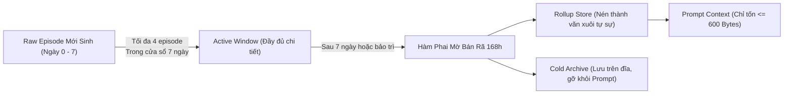

# Ký Ức Sự Kiện và Cơ Chế Phai Mờ Thời Gian (Episodic Memory & Episode Fading)

**Mã tài liệu**: `ARCH-MEM-03`  
**Ngày hiệu lực**: `08/11/2026`  
**Module tham chiếu**: `src/memory/episodic_memory.py`, `src/memory/living_user/episode_rollup.py`, `docs/knowledge/2026-11-02-episode-fading-memory-v1.md`, `tests/test_episode_fading.py`  
**Mục tiêu**: Phân tích bản chất của Episodic Memory (Ký ức sự kiện), tác dụng của nó trong hệ thống nhận thức Eris, và cơ chế phai mờ (Episode Fading) giải quyết bài toán bùng nổ token và nhớ vặt vãnh.

---

## 1. Episodic Memory Là Gì? Phân Biệt Với Semantic Fact

Trong kiến trúc tâm trí của Eris, **Episodic Memory** đại diện cho những *biến cố, trải nghiệm cụ thể đã thực sự diễn ra tại một thời điểm nhất định*.

> *"Episodic không phải semantic fact. Nó giữ cảnh, lượt, outcome, evidence và độ nổi bật.  
> Một câu user sửa sai hôm nay là episode. Một fact ổn định chỉ lên semantic sau khi commit phù hợp."*  
> — Trích dẫn mã nguồn `src/memory/episodic_memory.py`

### Bảng So Sánh Episodic vs Semantic

| Đặc tính | Episodic Memory (Ký ức sự kiện) | Semantic Memory (Ký ức ngữ nghĩa) |
| :--- | :--- | :--- |
| **Bản chất** | Trải nghiệm mang tính thời gian, ngữ cảnh cụ thể. | Chân lý, quy luật, sự thật đã ổn định và độc lập thời gian. |
| **Ví dụ** | "Hôm qua lúc 22h, user cáu khi Eris giải thích lằng nhằng về async/await và yêu cầu chỉ đưa code." | "User ưa chuộng phong cách trả lời ngắn gọn, đi thẳng vào giải pháp code." |
| **Vòng đời** | Có tính phai mờ theo thời gian (decay theo hàm mũ). | Bền vững, tích lũy theo thời gian qua quá trình commit có kiểm soát. |
| **Cấu trúc lưu trữ** | Cảnh (`scene`), Lời nói (`user_input`), Hành động (`eris_action`), Kết quả (`outcome`), Chứng cứ (`evidence_ids`). | Khóa sự thật (`fact_key`), nội dung (`content`), độ tin cậy (`confidence`), độ nổi bật (`salience`). |

---

## 2. Cấu Trúc Bản Ghi Episodic Memory (`EpisodicMemoryItem`)

Mỗi sự kiện được ghi lại dưới dạng một đối tượng hoàn chỉnh:

```python
@dataclass(slots=True)
class EpisodicMemoryItem:
    id: str                        # Mã định danh duy nhất (epi_...)
    timestamp: str                 # Mốc thời gian ISO 8601
    frame_id: str = ""             # ID khung tương tác hiện hành
    summary: str = ""              # Tóm tắt cốt lõi của sự kiện
    scene: str = ""                # Hoàn cảnh / bối cảnh diễn ra
    user_input: str = ""           # Lời nói của người dùng (tối đa 500 ký tự)
    eris_action: str = ""          # Hành động / lời đáp của Eris
    outcome: str = ""              # Kết quả thực tế sau đó (user vui, hiểu ra, hay bực)
    confidence: float = 0.65       # Độ tin cậy của thông tin
    salience: float = 0.0          # Độ nổi bật / chấn động cảm xúc
    evidence_ids: list[str]        # Danh sách ID chứng cứ gắn kèm
    tags: list[str]                # Thẻ phân loại ngữ cảnh
    decay_policy: str = "normal"   # Chính sách phai mờ (normal / persistent / sticky)
    access_count: int = 0          # Số lần ký ức này đã được kéo lên
    metadata: dict[str, Any]       # Dữ liệu chưng cất, hash, chỉ số kiểm thử
```

### Tác dụng của Episodic Memory đối với Eris:
1. **Khả năng Ghi nhớ Nhân Quả (Causal Awareness)**: Eris hiểu được *tại sao* người dùng lại có thái độ như hiện tại thông qua chuỗi sự kiện dẫn đến nó.
2. **Cung cấp Bằng chứng Nguyên bản (Grounding Evidence)**: Khi cần xác minh một cam kết hoặc một thỏa thuận học tập cũ, Eris có thể trích xuất chính xác log sự kiện gốc.
3. **Nguồn nguyên liệu cho Học hỏi (Distillation Substrate)**: Các episode là dữ liệu đầu vào để quá trình bảo trì nền (Dreaming) chưng cất thành tri thức ngữ nghĩa và chân dung người học.

---

## 3. Vấn Nạn Bùng Nổ Token và Hiện Tượng "Nhớ Vặt"

Nếu giữ nguyên toàn bộ các episode theo thời gian:
1. **Khủng hoảng Token Budget**: Sau vài tuần sử dụng, hàng nghìn episode sẽ làm cạn kiệt context window của mô hình ngôn ngữ, tăng chi phí và độ trễ phản hồi.
2. **Hiệu ứng "Search Box Thiếu Ngủ"**: Ký ức bị kéo lên lộn xộn chỉ vì một vài từ khóa chung chung (ví dụ từ "lỗi" xuất hiện trong một câu chào cũ bị kéo lên làm Eris tưởng đang có lỗi mới).
3. **Mất Tính Tự Nhiên Của Con Người**: Bộ não con người không ghi nhớ từng mili-giây quá khứ; não bộ giữ lại ý nghĩa cốt lõi và làm mờ các chi tiết thừa thãi.

---

## 4. Cơ Chế Phai Mờ Ký Ức (Episode Fading Engine)

Để giải quyết bài toán trên, Eris triển khai cơ chế **Episode Fading v1** với 3 trụ cột kỹ thuật:



### 4.1. Hàm Suy Giảm Thời Gian Bán Rã (Exponential Half-Life Decay)
Hệ số cộng thưởng theo thời gian (`recency_prior`) của một episode được tính theo công thức phân rã bán rã 7 ngày ($168\text{ giờ}$):

$$\text{recency\_boost} = \text{clamp}_{0..1}\left(0.18 \times 0.5^{\frac{\Delta t_{\text{hours}}}{168.0}}\right)$$

- **Sự kiện vừa xảy ra ($\Delta t = 0$)**: Nhận tối đa $+0.18$ điểm cộng ưu tiên.
- **Sau đúng 7 ngày ($\Delta t = 168\text{h}$)**: Điểm cộng giảm một nửa còn $+0.09$.
- **Sau 14 ngày ($\Delta t = 336\text{h}$)**: Điểm cộng chỉ còn $+0.045$.
- **Sau 30 ngày**: Điểm cộng tiệm cận về $0.0$.

*Nguyên tắc bất biến*: Điểm thời gian (`recency`) chỉ đóng vai trò là **tie-breaker mềm**, không bao giờ được phép thắng điểm độ liên quan (`relevance`).

### 4.2. Cấu Trúc Phân Vùng Lưu Trữ Kép (Active vs Cold Archive)
- **Active Store (Tối đa 240 mục)**: Giữ các episode mới và các episode quan trọng có độ nổi bật cao (`salience >= 0.70`).
- **Cold Archive Store (`archive_cold`)**: Khi số lượng episode vượt ngưỡng, các episode cũ không bị xóa vứt đi mà được chuyển vào kho lạnh. Dữ liệu gốc vẫn còn trên đĩa để phục vụ truy vấn tra cứu lịch sử khi cần thiết, nhưng hoàn toàn bị loại khỏi prompt mặc định.

### 4.3. Nén Tự Sự Lăn (Narrative Rolling Recaps - Rollup)
Khi các episode vượt qua ngưỡng 7 ngày:
1. `EpisodeRollupStore` gom các episode cũ theo lô ($8\text{ episode/lần}$).
2. Gọi mô hình nén thành các đoạn văn tự sự ngắn gọn tiếng Việt, neo vào mốc ngày sự kiện (`YYYY-MM-DD`).
3. **Ràng buộc ngân sách**:
   - Tối đa **600 UTF-8 bytes** cho toàn bộ phần tóm lược quá khứ (`recap_tokens`).
   - Tối đa **3.000 UTF-8 bytes** cho toàn bộ phần episode (gồm cả episode mới + recap).
   - Đo lường bằng UTF-8 bytes thật, không ước lượng theo kiểu `chars/3`, bảo đảm an toàn tuyệt đối cho context window.

### 4.4. Quyền Sửa Đổi và Quên Lãng (Correction & Forget Policies)
- **Soft-forget**: Loại bỏ diễn giải của episode cũ khỏi prompt và recall, nhưng giữ bản ghi gốc trên đĩa.
- **Hard-forget**: Thanh trừng toàn diện (`purge`) cả bản ghi active, archive lẫn các proposal chưa xử lý. Hệ thống lưu một mã băm tử niệm (`tombstone hash`) để ngăn các tiến trình nền vô tình nạp lại sự kiện đã bị xóa.

