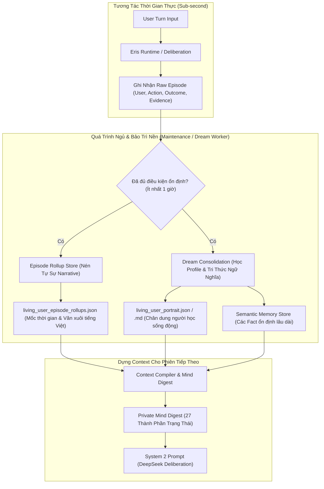

# Cơ Chế Hợp Nhất, Tóm Tắt Ký Ức và Cấu Trúc Mind Digest (Memory Consolidation & Summarization)

**Mã tài liệu**: `ARCH-MEM-02`  
**Ngày hiệu lực**: `08/11/2026`  
**Module tham chiếu**: `src/memory/living_user/service.py`, `src/memory/living_user/episode_rollup.py`, `src/cortex/agent_mind_persistence.py`, `src/runtime/context_compiler.py`  
**Mục tiêu**: Giải trình chi tiết toàn bộ các thành phần sinh ra khi hệ thống ký ức của Eris tiến hành tổng hợp (summary/consolidation/digest), và phân tích tác dụng nhận thức của từng thành phần.

---

## 1. Tổng Quan Kiến Trúc Hợp Nhất (Consolidation Pipeline)

Trong Eris, quá trình tổng hợp ký ức **không phải là một hàm tóm tắt đơn lẻ**. Đó là một chuỗi xử lý bất đồng bộ nhiều tầng (multi-tier asynchronous pipeline) chạy trong các lượt bảo trì nền (`maintenance worker`), tách biệt hoàn toàn khỏi luồng phản hồi thời gian thực (`real-time interaction loop`).



---

## 2. Bốn Thành Phần Sau Khi Ký Ức Được Summary / Hợp Nhất

Khi hệ thống ký ức thực hiện rollup, digest và consolidation, kết quả được phân tách thành 4 thành phần cấu trúc độc lập:

### Thành Phần 1: Chân Dung Người Học Sống Động (`Living User Portrait`)
- **Tập tin lưu trữ**: `living_user_portrait.json` và bản hiển thị người đọc `living_user_portrait.md`.
- **Cơ chế sinh**: Được chưng cất bởi `GeminiWebUserProfileAdapter` chạy nền, dựa trên toàn bộ chứng cứ quan sát hợp lệ.
- **Cấu trúc nội dung**:
  1. **`identity_and_roles`**: Định danh người học, chức danh, vai trò chính trong dự án.
  2. **`technical_competence`**: Ma trận năng lực lập trình, các công nghệ đã làm chủ, các điểm mù kiến thức (`knowledge gaps`).
  3. **`cognitive_and_learning_style`**: Phong cách nhận thức (thích học qua hình vẽ sơ đồ, thích làm ví dụ thực chiến trước hay thích đọc tài liệu nguyên lý trước).
  4. **`emotional_baseline_and_boundaries`**: Ngưỡng chịu đựng áp lực, cách phản ứng khi gặp bug khó, các ranh giới giao tiếp cần tôn trọng.
  5. **`active_projects_and_goals`**: Dự án đang theo đuổi, mục tiêu ngắn hạn trong tuần và tầm nhìn dài hạn.
- **Tác dụng**: Giúp Eris hiểu sâu sắc về người đang trò chuyện cùng mình mà không bao giờ bị "mất trí nhớ" giữa các phiên, tạo nên mối quan hệ sư phạm gắn kết lâu dài.

---

### Thành Phần 2: Bản Kể Quá Khứ Tự Sự (`Episode Narrative Rollup`)
- **Tập tin lưu trữ**: `living_user_episode_rollups.json`.
- **Hợp đồng sinh dữ liệu**:
  ```json
  {
    "schema_version": 1,
    "entries": {
      "global": {
        "segments": [
          {
            "anchor": "2026-11-02",
            "text": "Người dùng gặp lỗi rò rỉ bộ nhớ ở Live2D renderer do chưa giải phóng NativeArray; Eris đã cùng khoanh vùng được hàm dispose và thống nhất chuyển sang quản lý vòng đời tường minh."
          }
        ],
        "revision": 3,
        "coverage": {
          "epi_8f3a12bc": "a7b9c4...",
          "epi_9d114e02": "5c1f88..."
        }
      }
    }
  }
  ```
- **Quy tắc biên soạn**:
  - Không liệt kê danh sách ID hay trích dẫn thoại thô kệch.
  - Viết thành văn xuôi tiếng Việt tự nhiên, gộp theo mốc ngày cố định (`anchor: YYYY-MM-DD`).
  - **Giữ nguyên việc dở dang (`open_loops`)**: Không tự ý tuyên bố việc đã hoàn thành nếu thực tế chưa xong.
  - **Bảo tồn phủ định và điều kiện**: Ví dụ "Người dùng không đồng ý dùng thư viện bên thứ 3" tuyệt đối không được nén thành "Người dùng cân nhắc thư viện".
- **Tác dụng**: Nén hàng chục lượt chat chi tiết thành một bản tóm lược cô đọng dưới **600 UTF-8 bytes**, tiết kiệm hơn 85% chi phí token so với việc giữ lịch sử chat raw.

---

### Thành Phần 3: Trạng Thái Giấc Mơ & Chốt Kiểm Quyền Hạn (`Dream Checkpoint`)
- **Tập tin lưu trữ**: `living_user_dream_checkpoint.json`.
- **Cơ chế**:
  - Lưu trữ các đề xuất thay đổi profile đang chờ phê duyệt (`pending_proposals`).
  - Sử dụng dấu vân tay thẩm quyền (`authority_fingerprint`) để kiểm tra tính toàn vẹn.
  - Nếu quá trình bảo trì gặp sự cố (crash giữa chừng), hệ thống tự động phát lại (`replay`) các đề xuất chưa hoàn tất mà không cần gọi lại AI, đảm bảo tính bất biến dữ liệu (idempotence).
- **Tác dụng**: Ngăn chặn hiện tượng ký ức bị "ảo giác" (hallucination) do model tự bịa đặt chi tiết không có trong log tương tác gốc.

---

### Thành Phần 4: Bản Tóm Tắt Tâm Trí Đa Tầng (`Private Mind Digest` - 27 Thành Phần)
Mỗi khi Eris bước vào một lượt suy luận mới, `ContextCompiler` tổng hợp toàn bộ trạng thái bên trong thành một cấu trúc JSON 27 thành phần đưa vào System 2:

| STT | Thành phần (`Key`) | Kiểu dữ liệu | Tác dụng nhận thức trong lượt tương tác |
| :---: | :--- | :--- | :--- |
| 1 | `mind_state` | Dict | Mục tiêu nhận thức tức thời, hướng chú ý của Eris. |
| 2 | `memory_state` | Dict | Danh sách các node ký ức đang cộng hưởng với câu hỏi. |
| 3 | `living_user` | Dict | Trích đoạn chân dung người dùng liên quan tới chủ đề này. |
| 4 | `tom_history` | List | Lịch sử Thuyết Tâm Trí (Theory of Mind): phỏng đoán ý đồ của user. |
| 5 | `affective_residue` | Dict | Dư chấn cảm xúc đọng lại từ các lượt tương tác trước. |
| 6 | `emotional_resonance`| Float | Mức độ đồng cảm và giao động cảm xúc của Eris. |
| 7 | `repair_context` | Dict | Bối cảnh sửa sai đang xử lý (nếu có). |
| 8 | `stance` | String | Thái độ hiện tại: `supportive`, `pedagogical`, `quiet_companion`. |
| 9 | `active_goals` | List | Các mục tiêu học tập đang diễn ra. |
| 10 | `open_loops` | List | Những câu hỏi hoặc bài tập chưa có lời giải đáp chốt hạ. |
| 11 | `nonverbal_state` | Dict | Trạng thái Live2D: biểu cảm mặt, tư thế đầu, hơi thở. |
| 12 | `discourse_state` | Dict | Nhịp điệu đối thoại: ai đang giữ lượt nói, độ dài câu trả lời. |
| 13 | `curriculum_focus` | Dict | Kỹ năng hoặc khái niệm trọng tâm đang giảng dạy. |
| 14 | `misconception_flags`| List | Các cảnh báo về hiểu sai bản chất của học viên. |
| 15 | `scaffold_level` | Int | Mức độ hỗ trợ: từ gợi ý tối thiểu (1) đến giải thích chi tiết (4). |
| 16 | `fsrs_due_cards` | List | Danh sách kiến thức đến hạn ôn tập theo scheduler. |
| 17 | `workspace_screen` | Dict | Dữ liệu màn hình hoặc file code thực tế đang hiển thị. |
| 18 | `grounding_evidence`| List | Các bằng chứng xác thực được phép dùng làm căn cứ. |
| 19 | `relational_trust` | Float | Điểm tin cậy quan hệ tích lũy qua thời gian. |
| 20 | `cognitive_load` | Float | Ước lượng mức độ quá tải não bộ của học viên. |
| 21 | `initiative_pressure`| Float | Áp lực phải tự lên tiếng hay tiếp tục im lặng quan sát. |
| 22 | `canvas_state` | Dict | Trạng thái hiển thị trên bảng vẽ tương tác Learning Canvas. |
| 23 | `speech_contract` | Dict | Cấu hình giọng nói TTS (ngôn ngữ: vi/ja/en, tốc độ, cảm xúc). |
| 24 | `recent_episodes` | List | Tối đa 4 sự kiện cụ thể mới nhất trong 7 ngày. |
| 25 | `episode_recap` | String | Văn xuôi tự sự nén các sự kiện cũ hơn 7 ngày. |
| 26 | `self_continuity` | Dict | Khẳng định bản ngã và ký ức liên tục xuyên suốt của Eris. |
| 27 | `behavior_rules` | List | Các ràng buộc hành vi được kích hoạt theo ngữ cảnh hiện tại. |

---

## 3. Tác Dụng Về Mặt Vận Hành và Hiệu Năng

1. **Giải phóng áp lực Token Budget**:
   Nhờ chuyển đổi từ *Raw Chat Logs* sang *Narrative Rollups + Living Portrait*, prompt nạp vào LLM giảm từ hàng chục nghìn token xuống còn chưa đầy **1.500 - 2.500 tokens**, giảm chi phí API và hạ thời gian phản hồi (Time-To-First-Token).
2. **Bảo tồn Bản ngã Liên tục (Self-Continuity)**:
   Eris không bao giờ bị rơi vào tình trạng "mất trí nhớ từng phiên" như các chatbot truyền thống. Khi người dùng mở app sau một tuần vắng bóng, Eris vẫn nhớ chính xác dự án đang làm dở và cảm xúc của phiên trước.
3. **Chống Hiện Tượng Thoái Hóa Ký Ức (Catastrophic Forgetting & Drift)**:
   Quá trình chưng cất có kiểm soát thẩm quyền (`authority guard`) đảm bảo những hiểu biết cốt lõi không bị thay thế tùy tiện bởi một vài câu nói bông đùa nhất thời.

