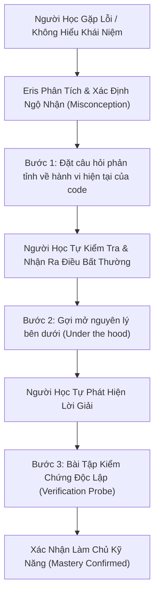
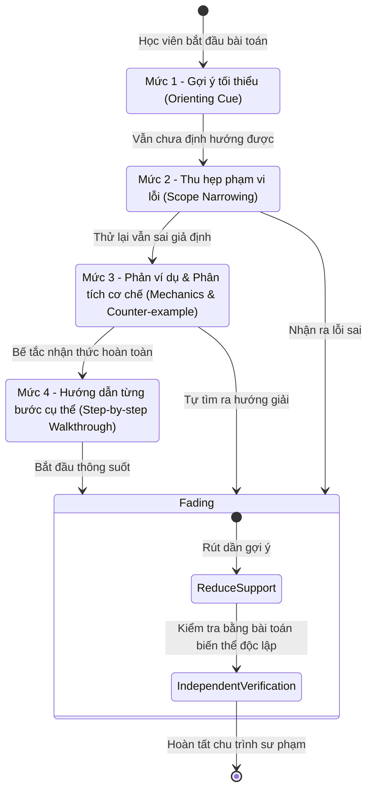
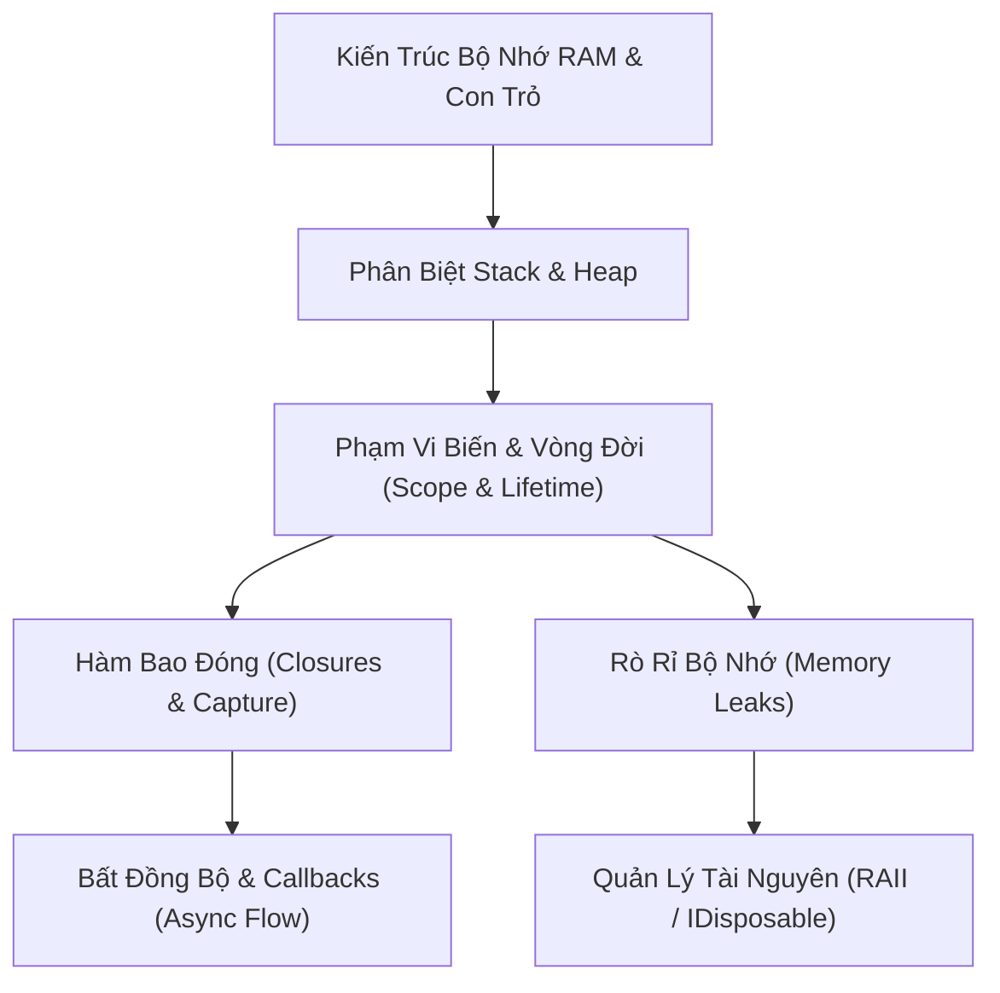

# Nền Tảng Sư Phạm Socrates và Trí Tuệ Học Tập Thích Ứng (Pedagogical Foundations & Adaptive Tutor)

**Mã tài liệu**: `ARCH-TUTOR-01`  
**Ngày hiệu lực**: `08/11/2026`  
**Module tham chiếu**: `src/runtime/tutor/`, `src/runtime/tutor/insights.py`, `src/runtime/tutor/adaptive_policy.py`, `docs/knowledge/2026-11-01-tutor-p2-adaptive-learning-vi.md`, `docs/knowledge/2026-11-05-learning-p3-dynamic-knowledge-graph-vi.md`  
**Mục tiêu**: Trình bày toàn bộ cơ sở lý luận sư phạm, các phương pháp luận giáo dục kinh điển (Socrates, Vygotsky ZPD, Scaffolding), đồ thị phụ thuộc khái niệm (Concept DAG), chẩn đoán ngộ nhận, và thuật toán lặp lại ngắt quãng FSRS v6.3.2 được tích hợp trong ErisTutor.

---

## 1. Triết Lý Sư Phạm Socrates (The Socratic Method)

Khác biệt cốt lõi giữa ErisTutor và các AI trợ lý code thông thường (như ChatGPT hay GitHub Copilot) nằm ở **mục tiêu sư phạm**:

| Tiêu chí | Trợ lý Code Thông Thường (Copilot / Chatbot) | Eris Socratic Tutor |
| :--- | :--- | :--- |
| **Hành vi** | Đưa ra toàn bộ code hoàn chỉnh ngay lập tức (Spoon-feeding). | Đặt câu hỏi gợi mở, hướng dẫn người học tự tư duy giải quyết vấn đề. |
| **Hiệu quả tức thời** | Xong việc ngay, nhưng người dùng không học được gì mới. | Tốn nhiều nỗ lực suy nghĩ hơn, nhưng biến kiến thức thành kỹ năng cá nhân. |
| **Kỹ năng hình thành** | Thói quen phụ thuộc vào AI (Cognitive Offloading). | Khả năng tư duy phản biện, tự debug và làm chủ nguyên lý sâu. |

---

## 2. Vùng Phát Triển Gần Nhất (Vygotsky's Zone of Proximal Development - ZPD)

Eris áp dụng lý thuyết phát triển nhận thức của nhà tâm lý học giáo dục **Lev Vygotsky**:

1. **Vùng Đã Làm Chủ (Actual Development Level)**: Những kỹ năng mà người học có thể tự thực hiện độc lập mà không cần bất kỳ gợi ý nào.
2. **Vùng Phát Triển Gần Nhất (ZPD)**: Những bài toán nằm ngay sát ranh giới năng lực hiện tại, người học chưa tự giải được một mình nhưng **có thể giải quyết thành công khi có giàn giáo hỗ trợ phù hợp**.
3. **Vùng Quá Khó (Beyond Reach)**: Những chủ đề quá trừu tượng so với nền tảng hiện có, nếu cố học sẽ dẫn đến chán nản và kiệt sức nhận thức (`cognitive burnout`).

### Nguyên Tắc Bằng Chứng Trong `insights.py`:
- **Tách biệt bài làm độc lập và bài làm có gợi ý**:
  Một câu nói *"Em hiểu rồi"* hoặc việc người học chạy đúng code sau 3 lần Eris đưa gợi ý **chưa bao giờ được xem là đã làm chủ kỹ năng**.
- Hệ thống đánh dấu cờ:
  - `needs_independent_probe`: Kỹ năng cần có bài test độc lập không hỗ trợ để xác thực.
  - `possible_repeated_gap`: Phát hiện lỗi sai lặp đi lặp lại cùng một bản chất dù đã được hướng dẫn.
  - `unassessed`: Chủ đề mới xuất hiện chưa có dữ liệu đo lường tin cậy.

---

## 3. Kỹ Thuật Giàn Giáo Nhận Thức (Instructional Scaffolding)

Giàn giáo (`Scaffolding`) là cấu trúc hỗ trợ tạm thời mà Eris dựng lên xung quanh người học để giúp họ vượt qua ZPD:

- **Quy tắc Rút giàn giáo (Fading Process)**: Ngay khi học viên thể hiện tín hiệu đã hiểu nguyên lý, Eris lập tức lùi lại, không giảng giải thêm, nhường sân khấu thực hành cho học viên.

---

## 4. Đồ Thị Phụ Thuộc Khái Niệm (Concept Dependency Graph - DAG)

Kiến thức kỹ thuật không phải là một danh sách phẳng tuyến tính. ErisTutor mô hình hóa toàn bộ chương trình học dưới dạng một **Đồ Thị Có Hướng Không Chu Trình (DAG)**:

### Cơ chế Hoạt động:
1. **Truy vết Tiên quyết (Prerequisite Tracing)**:
   Khi học viên gặp khó khăn với khái niệm nâng cao (ví dụ: `Closures`), Eris không lặp lại lý thuyết về Closure mà tự động duyệt ngược đồ thị để kiểm tra xem học viên đã nắm vững `Scope & Lifetime` hay chưa.
2. **Mở rộng Chương trình Có Kiểm Soát (`preview_expansion` & `apply_expansion`)**:
   Khi phát hiện người học có nhu cầu học thêm môn mới (Toán rời rạc, Đồ họa máy tính, Thuật toán), Eris đề xuất mở rộng đồ thị kỹ năng tối đa 8 node/lần, yêu cầu xác nhận của người học trước khi tích hợp vào SQLite chính thức.

---

## 5. Thuật Toán Lặp Lại Ngắt Quãng FSRS (Free Spaced Repetition Scheduler v6.3.2)

Để giải quyết đường cong quên lãng của Ebbinghaus, ErisTutor tích hợp bộ lập lịch hiện đại **FSRS v6.3.2** dựa trên mô hình ba tham số **DSR**:

1. **Difficulty ($D \in [1, 10]$)**: Độ khó nội tại của khái niệm đối với riêng người học này.
2. **Stability ($S > 0$)**: Độ bền vững của ký ức (thời gian tính bằng ngày để xác suất gợi nhớ giảm từ 100% xuống 90%).
3. **Retrievability ($R \in [0, 1]$)**: Xác suất gợi nhớ thành công tại thời điểm hiện tại:
   $$R(t) = \left(1 + \text{factor} \times \frac{t}{S}\right)^{-\text{decay}}$$

### Ba Chế Độ Vận Hành (`retention_mode`):
- **`shadow` (Mặc định)**: Eris tính toán lịch ôn tập ngầm trong bóng mờ, quan sát sự phai mờ kiến thức nhưng **không tự ý chiếm quyền lịch học** hoặc bắn thông báo quấy rầy.
- **`heuristic`**: Lập lịch dựa trên các mốc thời gian kinh điển (1 ngày, 3 ngày, 7 ngày, 14 ngày, 30 ngày) khi môi trường thiếu thư viện `fsrs`.
- **`fsrs`**: Kích hoạt thuật toán tối ưu hóa đầy đủ khi có thư viện `fsrs==6.3.2`, tính toán chính xác ngày cần ôn tập để đạt tỷ lệ nhớ mục tiêu ($90\%$).

---

## 6. Không Gian Bảng Phấn Học Tập Số (Learning Canvas)

Bên cạnh khung chat văn bản, Eris tương tác với người học thông qua **Learning Canvas** (Bảng vẽ học tập tương tác chạy trên nền Web / Godot):

- **Hiển thị Song Song**: Một bên là Eris đối thoại sư phạm, một bên là Canvas trực quan.
- **Thành phần trên Canvas**:
  - Sơ đồ tư duy và biểu đồ luồng dữ liệu (Mermaid render).
  - Công thức Toán học chuẩn LaTeX qua KaTeX (`\int`, `\sum`, ma trận).
  - Khung code động có highlight cú pháp và trỏ mũi tên vào dòng bị lỗi.
  - Thẻ tiến độ học tập và thẻ ôn tập FSRS.
- **Tác dụng**: Giảm tải nhận thức qua kênh thính giác/văn bản thuần túy, tận dụng sức mạnh của kênh thị giác không gian để người học tiếp thu kiến thức nhanh hơn gấp nhiều lần.

