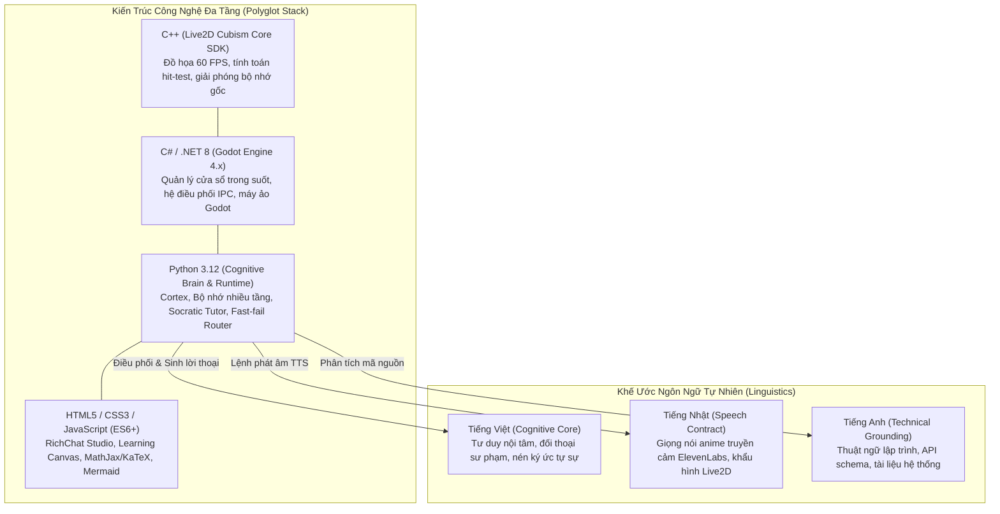

# Kiến Trúc Đa Ngôn Ngữ: Kỹ Thuật Đa Tầng và Khế Ước Ngôn Ngữ Tự Nhiên (Polyglot Architecture & Linguistics)

**Mã tài liệu**: `ARCH-LANG-01`  
**Ngày hiệu lực**: `08/11/2026`  
**Module tham chiếu**: `src/live2d_body/`, `src/body/richchat/`, `src/runtime/public_output_runtime.py`, `src/memory/episodic_memory.py`, `docs/knowledge/2026-10-16-tts-vi-ja-live-switch.md`  
**Mục tiêu**: Làm rõ toàn bộ bức tranh về "ngôn ngữ" trong Eris: từ ngôn ngữ lập trình kỹ thuật (Polyglot Tech Stack) đến hợp đồng ngôn ngữ tự nhiên và ngữ âm (Linguistics & Multilingual Speech Contract).

---

## 1. Bức Tranh Tổng Thể Về "Ngôn Ngữ" Trong Eris

Câu hỏi *"Eris dùng ngôn ngữ nào?"* bao gồm hai khía cạnh mật thiết:
1. **Ngôn ngữ Kỹ thuật (Polyglot Tech Stack)**: Sự kết hợp của 4 tầng công nghệ (C++, C#, Python, Web) để tạo nên một sinh thể số mượt mà, phản xạ nhanh và suy tưởng sâu.
2. **Ngôn ngữ Tự nhiên & Ngữ âm (Natural Language & Linguistics)**: Sự kết hợp của Tiếng Việt (Tư duy & Đối thoại), Tiếng Nhật (Giọng nói & Bản sắc biểu cảm), và Tiếng Anh (Thuật ngữ kỹ thuật & Tri thức toàn cầu).

---

## 2. Kiến Trúc Kỹ Thuật Đa Tầng (Polyglot Engineering Stack)

Eris không bị giới hạn trong một ngôn ngữ duy nhất mà tận dụng điểm mạnh tối đa của từng ngôn ngữ cho từng bài toán cụ thể:

### 2.1. C++ — Tầng Đồ Họa Cốt Lõi (Live2D Cubism Core SDK)
- **Vai trò**: Tương tác trực tiếp với SDK Live2D của Cubism, quản lý bộ nhớ native và dựng hình nhân vật 60 FPS.
- **Tác vụ cụ thể**:
  - Tính toán tọa độ mắt nhìn theo con trỏ chuột (`look_at`).
  - Xử lý va chạm chuột xuyên thấu (`mouse click-through & hit testing`) với độ trễ dưới **10ms**.
  - Quản lý vòng đời bộ nhớ (`NativeArray`), tránh rò rỉ RAM khi ứng dụng chạy nền nhiều ngày liên tục.

### 2.2. C# (.NET 8) — Tầng Nền Tảng Trò Chơi và Điều Phối Cửa Sổ (Godot 4.x Runtime)
- **Vai trò**: Cung cấp môi trường máy chủ trên desktop, quản lý cửa sổ đồ họa trong suốt (transparent borderless window) nổi trên màn hình người dùng.
- **Tác vụ cụ thể**:
  - Giao tiếp liên tiến trình (IPC Bridge) qua Named Pipes / Local Sockets giữa Brain và Body.
  - Nhúng trình duyệt WebView để hiển thị RichChat Studio và Learning Canvas.
  - Điều khiển logic chuyển động thân thể, hiệu ứng ánh sáng môi trường.

### 2.3. Python 3.12 — Tầng Trí Não Nhận Thức (Cognitive Brain & Cortex)
- **Vai trò**: Bộ não trung tâm của Eris, nơi chứa toàn bộ thuật toán thông minh, bộ nhớ và phương pháp sư phạm.
- **Tác vụ cụ thể**:
  - **Cortex & Deliberation Engine**: Suy luận sâu qua DeepSeek-V3/R1.
  - **Unified Memory Kernel**: Quản lý 6 tầng ký ức, tính điểm `MemoryScore`, chạy thuật toán phai mờ bán rã 168h.
  - **Socratic Tutor Executive**: Theo dõi đồ thị kỹ năng DAG, lập lịch ôn tập FSRS v6.3.2, chẩn đoán lỗ hổng tư duy.
  - **Fast-fail Model Router**: Giám sát timeout, điều phối luồng gọi AI và tự động chuyển đổi mô hình dự phòng.

### 2.4. HTML5 / CSS3 / JavaScript (ES6+) — Tầng Trực Quan Hóa (RichChat & Canvas)
- **Vai trò**: Không gian tương tác trực quan hiện đại, linh hoạt.
- **Tác vụ cụ thể**:
  - **RichChat Studio**: Giao diện chat kính mờ (glassmorphism), tin nhắn đa phương tiện, responsive controls.
  - **Learning Canvas**: Bảng vẽ số học tập, render công thức toán học chuẩn quốc tế với **KaTeX**, vẽ sơ đồ luồng dữ liệu tự động bằng **Mermaid.js**, highlight code thời gian thực với **Prism.js**.

---

## 3. Khế Ước Ngôn Ngữ Tự Nhiên & Ngữ Âm (Natural Linguistics Contract)

Eris là một thực thể đa ngôn ngữ được định hình theo một hợp đồng ngôn ngữ học chặt chẽ:

### 3.1. Tiếng Việt — Ngôn Ngữ Của Tư Duy Và Trái Tim
- **Vị trí**: Ngôn ngữ mẹ đẻ trong cấu trúc tâm trí của Eris.
- **Ứng dụng**:
  - **Inner Monologue (Độc thoại nội tâm / Deliberation)**: Mọi suy nghĩ, toan tính sư phạm, phân tích tâm lý người học trong System 2 đều diễn ra bằng Tiếng Việt.
  - **Đối Thoại & Văn Phong**: Sử dụng tiếng Việt tự nhiên, giàu sức gợi, chuẩn mực ngữ pháp nhưng ấm áp, loại bỏ hoàn toàn giọng văn dịch máy (machine translation tone) hoặc văn mẫu robot.
  - **Xử lý Ngôn ngữ Tự nhiên Đặc thù**:
    Trong `src/memory/episodic_memory.py`, Eris sở hữu bộ chuẩn hóa tiếng Việt riêng: bóc tách dấu thanh (`NFD normalization`), xử lý chữ "đ/d", và bộ lọc stopwords tiếng Việt tinh chỉnh 70 từ phổ biến để tránh recall sai lệch.

### 3.2. Tiếng Nhật — Bản Sắc Giọng Nói Và Biểu Cảm (Speech Persona)
- **Vị trí**: Ngôn ngữ của âm thanh và nghệ thuật biểu diễn.
- **Ứng dụng**:
  - Eris sử dụng mô hình giọng nói Nhật Bản qua **ElevenLabs** (hoặc voice model tùy biến), mang âm sắc trong trẻo, nhẹ nhàng, đặc trưng của phong cách anime companion.
  - Khẩu hình Live2D (`lip-sync`) được đồng bộ theo các nguyên âm tiếng Nhật ($A, I, U, E, O$) với độ trễ tối thiểu.
  - **Cơ chế Chuyển Đổi Linh Hoạt (Live VI/JA TTS Switch)**: Hệ thống hỗ trợ chuyển đổi linh hoạt: Eris có thể nói tiếng Việt với ngữ điệu tự nhiên hoặc nói tiếng Nhật kèm phụ đề tiếng Việt trên khung thoại, đáp ứng trọn vẹn sở thích cá nhân của người học.

### 3.3. Tiếng Anh — Ngôn Ngữ Của Kỹ Thuật Và Tri Thức
- **Vị trí**: Ngôn ngữ công cụ.
- **Ứng dụng**:
  - Đọc hiểu tài liệu lập trình, đặc tả API, code comments, tên biến và các thuật ngữ máy tính chuyên sâu.
  - Khi giảng dạy cho học viên Việt Nam, Eris giữ nguyên các thuật ngữ kỹ thuật chuẩn quốc tế (ví dụ: `Closure`, `Garbage Collection`, `Race Condition`) thay vì dịch gượng ép, nhưng giải thích cặn kẽ bản chất bằng tiếng Việt.

